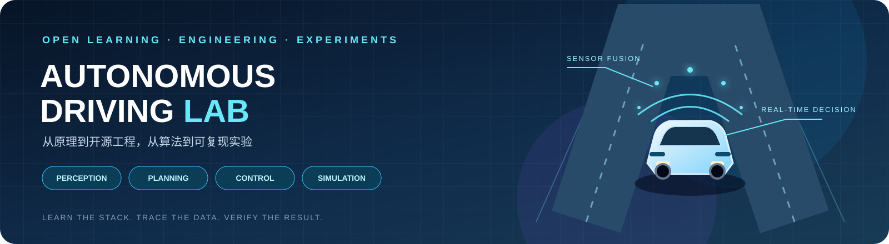
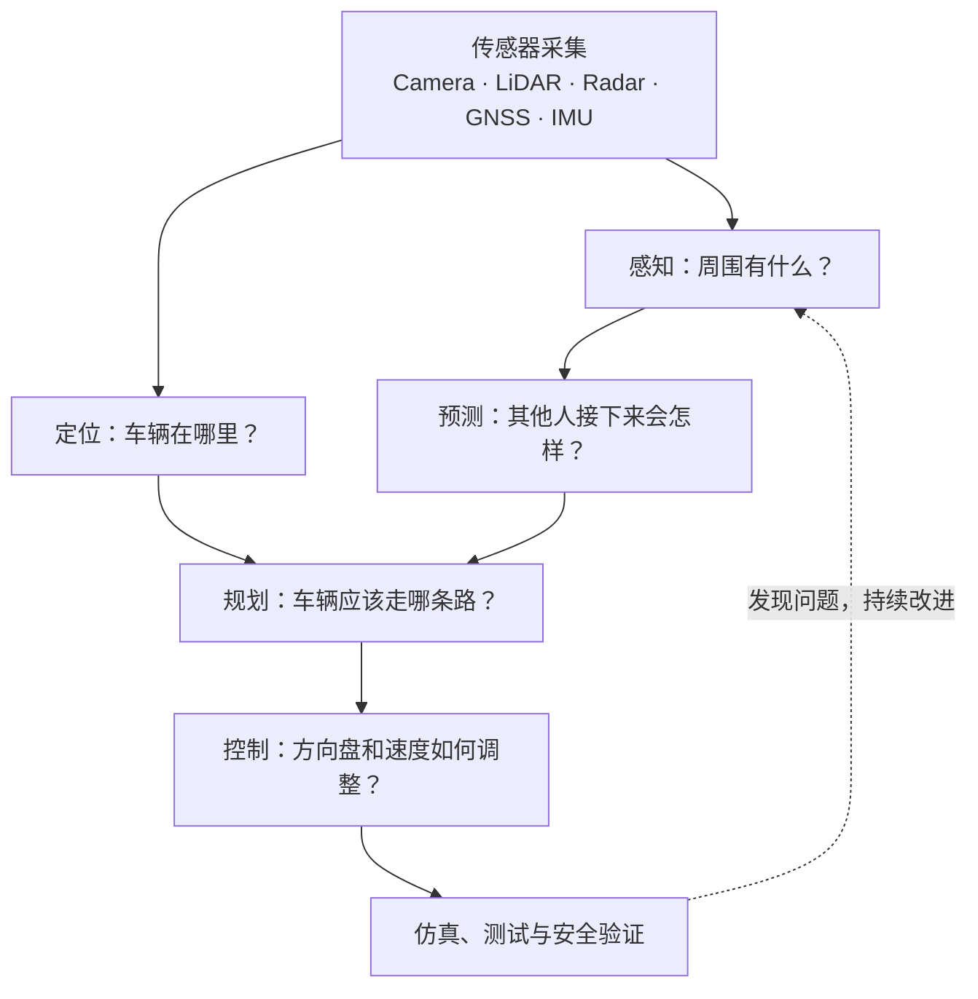
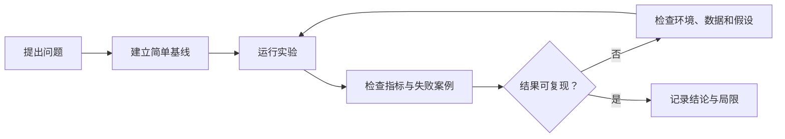

# AutomaticDriving 🚗
### 从零开始理解自动驾驶：路线图 · 开源项目 · 数据集 · 算法实验

<p align="center">
  
</p>

<p align="center">
  <b>把复杂的自动驾驶拆成容易理解、可以动手、能够验证的小问题。</b>
</p>

<p align="center">
  <a href="docs/learning-roadmap.md">学习路线</a> ·
  <a href="docs/resources.md">GitHub 优质资源</a> ·
  <a href="docs/open-source-projects.md">开源项目实战</a> ·
  <a href="docs/1000-questions.md">自动驾驶 1000 问</a> ·
  <a href="labs/README.md">动手实验</a>
</p>

[](https://github.com/ilikui/AutomaticDriving/actions/workflows/python-labs.yml)


---

## 👋 这个仓库是做什么的？

自动驾驶看起来很复杂，其实可以拆成一系列容易理解的问题：

- **车在哪里？** 定位、地图、GNSS、IMU、SLAM
- **周围有什么？** 摄像头、激光雷达、毫米波雷达、目标检测
- **其他交通参与者会怎么动？** 目标跟踪与运动预测
- **车应该怎么走？** 行为决策、路径规划、轨迹优化
- **怎样平稳地开过去？** 车辆运动学与控制
- **如何知道方案是否有效？** 数据集、仿真、指标、测试和回归验证

本仓库把这些主题组织成一份**中文自动驾驶学习地图**：不仅收集值得阅读的 GitHub 项目，也尽量提供通俗解释、循序渐进的路线、可运行的 Python 小实验，以及可复查的验证方法。

> 这是一份持续建设的学习与研究资料库，不是可直接用于真实道路驾驶的自动驾驶系统。项目列表不代表所有外部项目均已在本仓库环境中运行验证。

## 🗺️ 一张图看懂自动驾驶



这是一张便于入门的概念图。真实系统的模块划分、数据流和执行顺序会因项目与架构而不同。

## 🚀 新手从哪里开始？

不需要一开始就读懂几十万行代码。按下面的顺序，每一步做出一个小成果即可。

| 阶段 | 学什么 | 建议完成的小目标 |
|---|---|---|
| 01 · 编程基础 | Python、C++ 基础、Linux、Git | 能运行示例、读懂函数和配置 |
| 02 · 数学与车辆 | 向量、矩阵、概率、坐标系、车辆运动学 | 写出二维坐标变换 |
| 03 · 机器人基础 | ROS 2、Topic、TF、时间戳 | 理解节点如何交换传感器数据 |
| 04 · 感知与融合 | 图像、点云、检测、跟踪、传感器融合 | 跑通一个公开数据集基线 |
| 05 · 定位与规划 | GNSS/IMU、SLAM、路径与轨迹规划 | 理解定位结果如何影响规划 |
| 06 · 控制与仿真 | Pure Pursuit、PID、CARLA 场景 | 在仿真中记录轨迹和误差 |
| 07 · 系统工程 | 集成、测试、评测、部署与安全 | 写出可复现的实验报告 |

**推荐入口：** [分阶段学习路线](docs/learning-roadmap.md) · [自动驾驶 1000 问](docs/1000-questions.md) · [优质资源导航](docs/resources.md)

## 🧭 按目标找项目

以下是适合建立知识地图的代表性开源项目。请将它们视为学习入口，而不是简单的排行榜。

| 我想学习什么 | 从这些项目开始 | 为什么值得看 |
|---|---|---|
| 完整自动驾驶软件栈 | [Apollo](https://github.com/ApolloAuto/apollo)、[Autoware](https://github.com/autowarefoundation/autoware) | 了解模块如何组成系统 |
| 驾驶仿真与场景测试 | [CARLA](https://github.com/carla-simulator/carla)、[Scenario Runner](https://github.com/carla-simulator/scenario_runner) | 在可控场景里观察车辆行为 |
| ROS 2 系统通信 | [ROS 2](https://github.com/ros2/ros2)、[Autoware Universe](https://github.com/autowarefoundation/autoware_universe) | 学习节点、消息、接口和集成 |
| 激光雷达 3D 检测 | [OpenPCDet](https://github.com/open-mmlab/OpenPCDet)、[MMDetection3D](https://github.com/open-mmlab/mmdetection3d) | 从数据配置走到模型评估 |
| 多传感器 / BEV 感知 | [BEVFusion](https://github.com/mit-han-lab/bevfusion)、[UniAD](https://github.com/OpenDriveLab/UniAD) | 理解多模态融合和统一任务研究 |
| 定位与 SLAM | [SLAM in Autonomous Driving](https://github.com/gaoxiang12/slam_in_autonomous_driving) | 结合代码理解定位建图 |
| 端到端驾驶研究 | [OpenDriveLab](https://github.com/OpenDriveLab/End-to-end-Autonomous-Driving)、[DriveLM](https://github.com/OpenDriveLab/DriveLM) | 了解端到端方法与驾驶推理研究 |
| 真实车辆软件项目 | [openpilot](https://github.com/commaai/openpilot) | 观察真实软件工程、模型和车辆接口的组织方式 |

更多项目按类别整理在 [GitHub 优质项目清单](docs/resources.md) 与 [开源工程实践指南](docs/open-source-projects.md)。外部项目的活跃度、依赖、许可证和硬件要求可能变化，使用前请查看其最新文档。

## 🧪 先运行几个小实验

本仓库提供一些不依赖大型模型或 GPU 的 Python 基础实验。它们帮助你理解核心概念，再逐步过渡到完整框架。

### 环境

建议使用 Python 3.11 或 3.12。基础实验尽量使用 Python 标准库。

```bash
# 运行全部 Python 单元测试
python -m unittest discover -s labs/python -p 'test_*.py' -v

# 理解卡尔曼滤波：如何根据带噪声的观测估计状态
python labs/python/kalman_1d.py

# 理解坐标系：如何把点从一个坐标系变换到另一个坐标系
python labs/python/coordinate_transform_2d.py

# 理解融合：多个带有不同不确定性的观测如何组合
python labs/python/sensor_fusion_1d.py

# 观察异常值处理
python labs/python/sensor_fusion_robust.py

# 理解车辆轨迹跟踪
python labs/python/pure_pursuit.py
```

实验目录和每个脚本的用途见 [labs/README.md](labs/README.md)。执行结果以本地实际运行输出为准。

## 🔬 从“看懂”到“会验证”

学习一个算法时，建议每次都回答这 6 个问题：

1. **输入是什么？** 单位、坐标系、时间戳和数据格式分别是什么？
2. **输出是什么？** 输出代表什么物理量，单位是什么？
3. **依赖哪些假设？** 例如噪声模型、车辆模型或传感器安装位置。
4. **怎样衡量好坏？** 选择与任务对应的指标，而不只看一张效果图。
5. **失败时会怎样？** 检查异常输入、延迟、丢帧、遮挡和极端场景。
6. **别人能复现吗？** 记录代码版本、数据集、配置、依赖和运行命令。



## 📚 仓库导航

| 内容 | 你会找到什么 |
|---|---|
| [学习路线](docs/learning-roadmap.md) | 从编程基础到系统工程的分阶段路径 |
| [优质资源导航](docs/resources.md) | GitHub 项目、官方文档、论文和数据集 |
| [开源工程实践](docs/open-source-projects.md) | 如何选项目、读代码、做小实验 |
| [论文与研究方向](docs/papers-and-research.md) | 研究主题和论文阅读方法 |
| [数据集与评测](docs/datasets-and-benchmarks.md) | 数据集入口、任务与评价指标 |
| [自动驾驶 1000 问](docs/1000-questions.md) | 按主题组织的学习问题 |
| [实验目录](labs/README.md) | 可运行示例、命令与实验说明 |
| [CARLA 复现实验指南](docs/carla-reproducibility.md) | 场景配置、记录和回归验证 |
| [工程实践手册](docs/engineering-playbook.md) | 接口检查、故障定位和实验模板 |
| [贡献指南](CONTRIBUTING.md) | 如何修正、补充和维护内容 |

## 🧰 技术栈速览

- **编程与计算：** Python、C++、Linux、Git、NumPy
- **机器人基础设施：** ROS 2、TF2、rosbag
- **感知：** OpenCV、PyTorch、OpenPCDet、MMDetection3D
- **定位与建图：** GNSS、IMU、LiDAR SLAM、地图
- **规划与控制：** 车辆运动学、轨迹优化、PID、Pure Pursuit
- **仿真与验证：** CARLA、Scenario Runner、单元测试、持续集成

这不是要求一次性学完的技术清单。请根据当前阶段选择一项，先跑通、再理解、再扩展。

## ⚠️ 使用边界与许可

- 本仓库主要用于学习、研究与离线实验，不构成道路安全或功能安全认证。
- 不要将教学脚本或未经充分验证的开源代码直接连接真实车辆或用于道路控制。
- 使用外部代码、模型权重和数据集前，请分别核验代码许可证、权重条款和数据集许可。
- 公开指标不等于真实道路表现；仿真成功也不能单独证明系统安全。

## 🤝 一起完善这份学习地图

欢迎提交 Issue 或 Pull Request，补充高质量项目、中文解释、可复现实验和勘误。推荐提交时说明：

- 项目解决什么问题，适合什么阶段；
- 官方仓库、文档、论文与许可证；
- 环境要求、运行方式和已知限制；
- 为什么值得学习，以及建议从哪个文件开始读。

---

<p align="center">
  <b>把问题拆小，把实验跑通，把结论讲清楚。</b><br/>
  从入门开始，逐步建立自己的自动驾驶知识体系。
</p>
