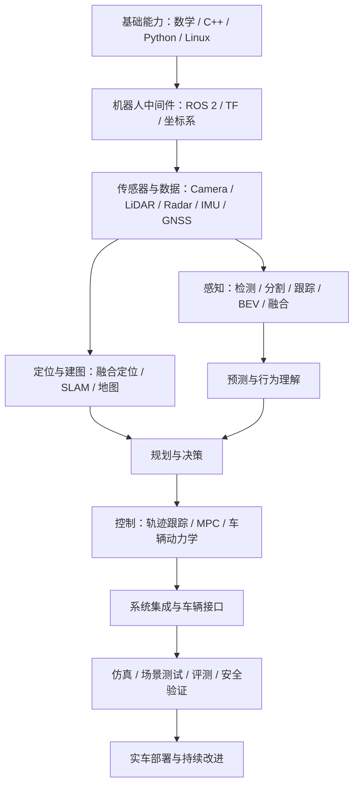

# AutomaticDriving：自动驾驶学习与实践知识库

> 面向自动驾驶初学者、算法学习者与工程开发者的中文学习路线、优质开源项目、论文、数据集和实践指南。

本仓库不追求堆积链接，而是按「基础能力 → 自动驾驶技术栈 → 开源工程 → 仿真验证 → 前沿研究」组织资料。优先引用官方文档、原始论文和可复现代码；外部资源的许可证、版本和运行要求以原项目为准。

## 从哪里开始

- **第一次系统学习**：先看 [学习路线](docs/learning-roadmap.md)，按阶段完成学习目标与实践任务。
- **寻找高质量资料**：查看 [资源导航](docs/resources.md)，按主题选择课程、文档和开源项目。
- **准备动手做项目**：查看 [开源工程实践](docs/open-source-projects.md)，从 CARLA 仿真、ROS 2 和 Autoware 入手。
- **阅读论文与复现算法**：查看 [论文与研究方向](docs/papers-and-research.md)。
- **查找公开数据集**：查看 [数据集与评测基准](docs/datasets-and-benchmarks.md)。
- **按问题系统学习**：查看 [自动驾驶 1000 问](docs/1000-questions.md)，用问题串联概念、工程与论文。
- **运行算法小实验**：查看 [可运行实验](labs/README.md)，包含 Kalman Filter、坐标变换、基础 / 鲁棒传感器融合和 Pure Pursuit；[Python Labs CI](.github/workflows/python-labs.yml) 会自动运行测试。

## 技术栈总览

## 核心官方资源

| 方向 | 资源 | 适合用途 |
|---|---|---|
| 自动驾驶系统 | [Autoware](https://github.com/autowarefoundation/autoware) · [官方文档](https://docs.autoware.org/) | ROS 2 开源自动驾驶软件栈、系统集成与车辆接入 |
| 自动驾驶系统 | [Apollo](https://github.com/ApolloAuto/apollo) · [开发者文档](https://apollo.baidu.com/) | 自动驾驶模块、工程架构和工具链 |
| 仿真 | [CARLA](https://github.com/carla-simulator/carla) · [文档](https://carla.readthedocs.io/) | 传感器仿真、算法测试、场景评估 |
| ROS 2 | [官方教程](https://docs.ros.org/en/rolling/Tutorials.html) | 节点、话题、服务、TF、Launch 与工具 |
| 3D 感知 | [OpenPCDet](https://github.com/open-mmlab/OpenPCDet) | 点云 3D 目标检测研究与复现 |
| 3D 感知 | [MMDetection3D](https://github.com/open-mmlab/mmdetection3d) | 3D 检测、数据处理和模型基准 |
| 数据集 | [nuScenes](https://www.nuscenes.org/) · [KITTI](https://www.cvlibs.net/datasets/kitti/) | 多传感器感知、检测与定位评测 |
| 数据集 | [Waymo Open Dataset](https://waymo.com/open/) | 大规模自动驾驶感知与运动数据研究 |

## 推荐学习原则

1. **先建立全局图，再深入单点**：理解感知、定位、预测、规划、控制之间的数据流和接口。
2. **每个主题都要有代码或实验**：不只收藏论文；记录环境、命令、数据、指标和失败原因。
3. **区分论文结果与工程能力**：论文指标不等于真实道路可靠性，仿真通过也不代表实车安全。
4. **版本先行**：记录操作系统、CUDA、ROS 发行版、框架版本和数据集版本，避免照搬过期教程。
5. **尊重数据与软件许可**：下载、训练、再分发和商业使用前，核对数据集与代码许可证。

## 目录

- [学习路线](docs/learning-roadmap.md)
- [资源导航](docs/resources.md)
- [开源工程实践](docs/open-source-projects.md)
- [论文与研究方向](docs/papers-and-research.md)
- [数据集与评测基准](docs/datasets-and-benchmarks.md)
- [自动驾驶 1000 问](docs/1000-questions.md)
- [可运行实验](labs/README.md)
- [贡献与维护原则](CONTRIBUTING.md)

## 维护说明

资源会随项目版本、论文进展和数据集政策变化。提交更新时请尽可能提供：资源名称、官方链接、适用方向、推荐理由、最后核验日期，以及已知的环境或许可限制。不要把「GitHub Star 数」作为唯一质量标准。

