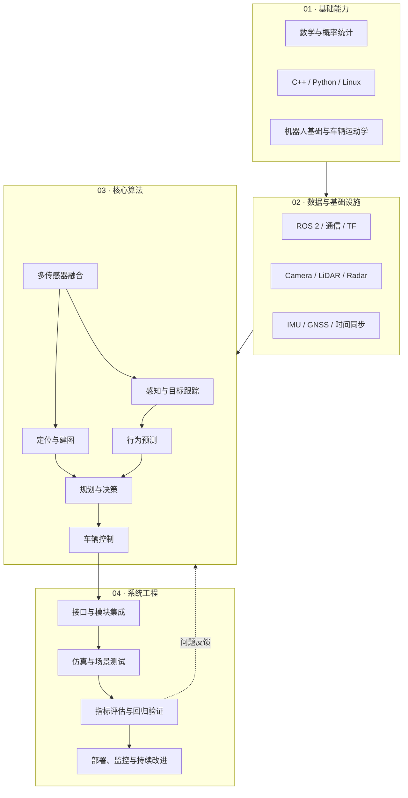
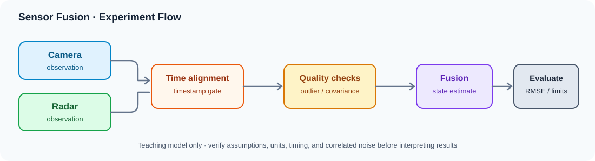
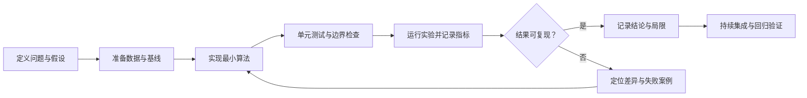

# AutomaticDriving

**自动驾驶学习、算法实践与工程验证知识库**

[](https://github.com/ilikui/AutomaticDriving/actions/workflows/python-labs.yml)
[](https://www.python.org/)
[](docs/)

<p align="center">
  
</p>

AutomaticDriving 是一个面向自动驾驶学习者、算法研究人员与工程开发者的中文知识库。仓库围绕自动驾驶技术栈，持续整理学习路线、官方文档、开源工程、论文与数据集，并通过可运行的 Python 小实验，将核心概念转化为可检查、可复现的实践内容。

项目采用**循序学习、优先引用一手资料、实验过程可追溯、结论边界明确**的维护原则。它既是系统化学习入口，也是一套逐步完善的算法实验与仿真验证工作台。

> **当前重点：** 自动驾驶知识体系建设、基础算法实验、单元测试与持续集成，以及 CARLA 场景复现方法整理。

---

## 目录

- [项目目标](#项目目标)
- [快速开始](#快速开始)
- [技术体系](#技术体系)
- [学习与研究导航](#学习与研究导航)
- [可运行实验](#可运行实验)
- [工程验证原则](#工程验证原则)
- [仓库结构](#仓库结构)
- [贡献与维护](#贡献与维护)

## 项目目标

本仓库以自动驾驶系统的典型数据流和工程流程为主线，重点建设以下内容：

| 建设方向 | 内容范围 | 目标 |
|---|---|---|
| 系统化学习 | 学习路线、主题导航、问题库 | 建立从基础知识到系统架构的整体认知 |
| 开源工程 | ROS 2、Autoware、Apollo、CARLA 等 | 理解真实项目的模块边界、接口与工程组织 |
| 算法实践 | 状态估计、坐标变换、传感器融合、轨迹跟踪 | 用小型实验理解算法假设与行为 |
| 研究阅读 | 论文主题、数据集、评测基准 | 建立从论文阅读到实验复现的工作流 |
| 验证与复现 | 单元测试、持续集成、仿真场景记录 | 让实验结果更容易复查、比较和回归 |

## 快速开始

建议按照以下顺序使用仓库：

1. **建立全局认知**：阅读[学习路线](docs/learning-roadmap.md)，了解各阶段的先修知识与实践目标。
2. **选择技术主题**：从[资源导航](docs/resources.md)和[自动驾驶 1000 问](docs/1000-questions.md)中确定当前问题。
3. **运行最小实验**：先阅读[实验目录](labs/README.md)，再运行对应的示例程序。
4. **验证行为**：执行单元测试，检查输入边界、数值结果与算法假设。
5. **扩展到仿真**：参考 [CARLA 场景复现指南](docs/carla-reproducibility.md)，记录环境、场景、种子和评价指标。

### 环境要求

- Python 3.11 或 3.12（持续集成目前针对这两个版本进行验证）。
- 基础实验优先使用 Python 标准库，不需要额外安装第三方依赖。
- CARLA 相关内容目前以实验规范和场景记录模板为主；实际仿真需要另行安装与配置匹配版本的 CARLA 及相关工具。

### 运行实验与测试

在仓库根目录执行：

```bash
# 运行单元测试
python -m unittest discover -s labs/python -p 'test_*.py' -v

# 运行状态估计示例
python labs/python/kalman_1d.py

# 运行二维坐标变换示例
python labs/python/coordinate_transform_2d.py

# 运行基础与鲁棒传感器融合示例
python labs/python/sensor_fusion_1d.py
python labs/python/sensor_fusion_robust.py
python labs/python/sensor_fusion_timing_covariance.py

# 运行 Pure Pursuit 控制与参数扫描
python labs/python/pure_pursuit.py
python labs/python/pure_pursuit_sweep.py
```

相关代码变更会触发 [Python Labs GitHub Actions](.github/workflows/python-labs.yml)，在 Python 3.11 和 3.12 环境中执行单元测试并运行实验脚本。请以工作流页面展示的最新运行结果为准。

## 技术体系

下图展示本仓库采用的学习与工程理解框架。实际系统的模块边界、执行顺序和数据依赖会因项目架构而有所不同。



## 学习与研究导航

| 文档 | 主要内容 | 推荐用途 |
|---|---|---|
| [学习路线](docs/learning-roadmap.md) | 分阶段学习目标与实践路径 | 制定学习计划 |
| [资源导航](docs/resources.md) | 官方文档、课程与主题资源 | 查找可靠资料 |
| [开源工程实践](docs/open-source-projects.md) | 主流开源项目与实践入口 | 从阅读资料转向工程代码 |
| [论文与研究方向](docs/papers-and-research.md) | 研究主题、论文阅读与复现思路 | 跟进算法研究 |
| [数据集与评测基准](docs/datasets-and-benchmarks.md) | 公开数据集、评价指标与使用注意事项 | 设计实验和比较结果 |
| [自动驾驶 1000 问](docs/1000-questions.md) | 按主题组织的工程问题与思考问题 | 构建问题驱动的知识体系 |
| [可运行实验](labs/README.md) | 实验索引、运行命令与记录方法 | 理解算法并验证实现 |
| [CARLA 场景复现指南](docs/carla-reproducibility.md) | 场景配置、指标记录与回归流程 | 规划可复现的仿真实验 |
| [贡献与维护原则](CONTRIBUTING.md) | 内容组织、提交与维护规范 | 参与完善知识库 |

### 官方项目与一手资料

- **自动驾驶软件栈**：[Autoware](https://github.com/autowarefoundation/autoware) · [Autoware 文档](https://docs.autoware.org/) · [Apollo](https://github.com/ApolloAuto/apollo) · [Apollo 开发者平台](https://apollo.baidu.com/)
- **仿真与场景测试**：[CARLA](https://github.com/carla-simulator/carla) · [CARLA 文档](https://carla.readthedocs.io/) · [Scenario Runner](https://github.com/carla-simulator/scenario_runner)
- **机器人中间件**：[ROS 2 官方教程](https://docs.ros.org/en/rolling/Tutorials.html)
- **三维感知框架**：[OpenPCDet](https://github.com/open-mmlab/OpenPCDet) · [MMDetection3D](https://github.com/open-mmlab/mmdetection3d)
- **公开数据集**：[KITTI](https://www.cvlibs.net/datasets/kitti/) · [nuScenes](https://www.nuscenes.org/) · [Waymo Open Dataset](https://waymo.com/open/)

以上链接用于学习与研究导航。具体功能、维护状态、版本兼容性和使用许可，请以各项目发布的官方说明为准。

## 可运行实验

当前实验以小规模、可检查的示例为主，目的是帮助理解算法原理和验证基础行为，不代表完整的量产级实现。

<p align="center">
  
</p>

### 从问题到可复现实验



| 实验主题 | 主要内容 | 入口 |
|---|---|---|
| 状态估计 | 一维匀速模型 Kalman Filter | [代码](labs/python/kalman_1d.py) |
| 坐标变换 | 二维齐次变换、矩阵组合与逆变换 | [代码](labs/python/coordinate_transform_2d.py) |
| 基础传感器融合 | 基于测量方差的标量加权融合 | [代码](labs/python/sensor_fusion_1d.py) |
| 鲁棒传感器融合 | 中位数 / MAD 异常值门控与加权融合 | [代码](labs/python/sensor_fusion_robust.py) |
| 时间同步与相关噪声 | 时间偏差门控、已知协方差下的两观测融合 | [代码](labs/python/sensor_fusion_timing_covariance.py) |
| 轨迹跟踪 | Pure Pursuit 转向计算与运动学演示 | [代码](labs/python/pure_pursuit.py) |
| 控制参数评估 | 固定 / 速度自适应前视距离对比 | [代码](labs/python/pure_pursuit_sweep.py) |
| 仿真实验规范 | CARLA 场景记录模板与回归方法 | [指南](docs/carla-reproducibility.md) |

实验索引、测试文件和运行说明见 [labs/README.md](labs/README.md)。

## 工程验证原则

为提高内容的可信度和可复查性，仓库遵循以下原则：

1. **明确假设**：说明输入、输出、单位、坐标系、噪声模型和适用范围。
2. **测试边界条件**：除正常输入外，覆盖非法参数、异常数值和退化场景。
3. **记录实验环境**：尽可能保存代码版本、依赖版本、数据来源、配置和随机种子。
4. **报告实际结果**：区分已运行验证、理论分析、待完成工作和预期目标，不以计划代替测试结果。
5. **谨慎解释指标**：合成数据和简化运动学模型仅能支持有限结论；单次仿真成功不能证明真实道路安全。
6. **尊重许可与安全边界**：遵守数据集、软件和模型的许可要求，不将教学实验直接用于实车控制。

## 仓库结构

```text
AutomaticDriving/
├── README.md
├── CONTRIBUTING.md
├── docs/
│   ├── learning-roadmap.md
│   ├── resources.md
│   ├── open-source-projects.md
│   ├── papers-and-research.md
│   ├── datasets-and-benchmarks.md
│   ├── 1000-questions.md
│   └── carla-reproducibility.md
├── labs/
│   ├── README.md
│   ├── python/
│   │   ├── kalman_1d.py
│   │   ├── coordinate_transform_2d.py
│   │   ├── sensor_fusion_1d.py
│   │   ├── sensor_fusion_robust.py
│   │   ├── sensor_fusion_timing_covariance.py
│   │   ├── pure_pursuit.py
│   │   └── pure_pursuit_sweep.py
│   └── carla/
│       └── scenario-template.yaml
└── .github/
    └── workflows/
        └── python-labs.yml
```

## 贡献与维护

欢迎通过 Issue 或 Pull Request 提交修正、补充实验、完善说明和更新资源。

提交内容建议包含：

- 问题背景、修改目的与适用范围；
- 官方文档或原始论文等可核验来源；
- 可复现的运行命令、环境版本与测试结果；
- 已知限制、许可证信息和后续改进方向。

外部链接、项目版本和数据集政策可能发生变化，维护时应优先核验一手来源。仓库不会仅凭 Star 数、榜单排名或单一论文指标判断资源质量。

---

**持续学习，重视验证；从算法原理出发，以可复现实验沉淀工程认知。**
