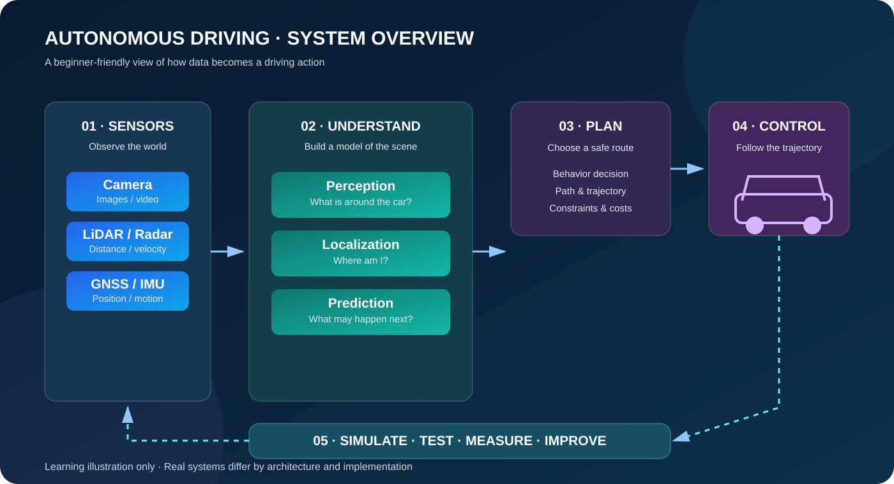
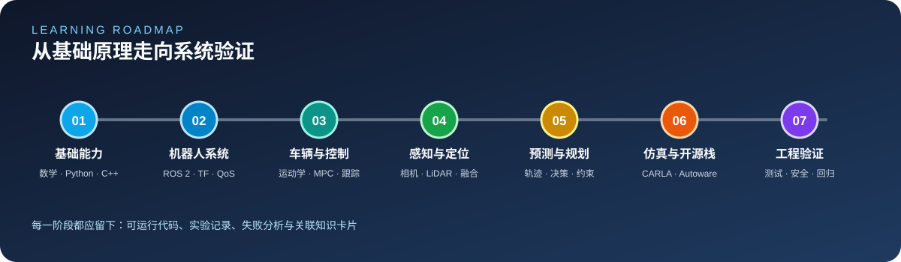

# AutomaticDriving

<p align="center">
  
</p>

<p align="center">
  <strong>A structured, practice-oriented knowledge base for autonomous driving.</strong><br/>
  Learning roadmap · Open-source projects · Datasets · Research topics · Reproducible experiments
</p>

<p align="center">
  <a href="docs/learning-roadmap.md">Learning Roadmap</a> ·
  <a href="docs/resources.md">Resource Directory</a> ·
  <a href="docs/open-source-projects.md">Project Studies</a> ·
  <a href="docs/algorithm-cookbook.md">Algorithm Cookbook</a> ·
  <a href="docs/1000-questions.md">1000 Questions</a> ·
  <a href="labs/README.md">Practical Labs</a>
</p>

[](https://github.com/ilikui/AutomaticDriving/actions/workflows/python-labs.yml)


---

## Overview

**AutomaticDriving** is an open learning and research repository for understanding autonomous-driving systems, their algorithms, software architecture, datasets, and validation workflows. It organizes a broad subject into a navigable curriculum and connects conceptual material with representative open-source implementations and small, reproducible experiments.

The repository is intended for students, engineers, and independent learners. The main content is written in Chinese, with original project names and official references retained where appropriate.

### Scope

- **Foundations:** Python, C++, Linux, mathematics, probability, coordinate systems, and vehicle dynamics.
- **Robotics infrastructure:** ROS 2, TF2, message transport, timestamps, calibration, and data playback.
- **Perception:** camera vision, LiDAR point clouds, 2D/3D detection, segmentation, tracking, and sensor fusion.
- **Localization and mapping:** GNSS/IMU, odometry, SLAM, map representation, and localization evaluation.
- **Prediction, planning, and control:** motion prediction, behavior planning, trajectory generation, vehicle control, and constraints.
- **Simulation and validation:** scenario design, regression testing, benchmark protocols, failure analysis, and reproducibility.
- **System engineering:** software integration, interfaces, diagnostics, safety boundaries, and deployment considerations.

## System overview

<p align="center">
  
</p>

The diagram is a learning-oriented reference model, not a specification of any particular production system. Module boundaries, execution order, interfaces, and safety mechanisms differ across implementations.

## Learning pathway

| Stage | Core subjects | Suggested outcome |
|---|---|---|
| 1. Programming foundations | Python, C++, Linux, Git | Run examples and understand project structure |
| 2. Mathematics and vehicle models | Linear algebra, probability, geometry, kinematics | Implement a 2D coordinate transform |
| 3. Robotics middleware | ROS 2, nodes, topics, TF2, timestamps | Trace a sensor message through a small system |
| 4. Perception and fusion | Images, point clouds, detection, tracking | Evaluate a baseline on a public dataset |
| 5. Localization and mapping | GNSS/IMU, odometry, SLAM, maps | Explain pose estimates and their uncertainty |
| 6. Prediction, planning, and control | Trajectories, optimization, PID, Pure Pursuit | Measure tracking error in a controlled experiment |
| 7. Integration and validation | Simulation, scenarios, metrics, regression | Produce a reproducible experiment report |

<p align="center">
  
</p>

Start with the [learning roadmap](docs/learning-roadmap.md), then select a focused topic from the [1000 Questions guide](docs/1000-questions.md).

## Selected open-source projects

| Area | Representative projects | Study focus |
|---|---|---|
| Autonomous-driving platforms | [Apollo](https://github.com/ApolloAuto/apollo), [Autoware](https://github.com/autowarefoundation/autoware), [openpilot](https://github.com/commaai/openpilot) | System architecture, interfaces, integration, and testing |
| Robotics middleware | [ROS 2](https://github.com/ros2/ros2) | Nodes, topics, messages, transforms, and runtime behavior |
| Simulation and scenarios | [CARLA](https://github.com/carla-simulator/carla), [Scenario Runner](https://github.com/carla-simulator/scenario_runner), [CommonRoad](https://github.com/CommonRoad) | Controlled experiments and scenario-based validation |
| 3D perception | [OpenPCDet](https://github.com/open-mmlab/OpenPCDet), [MMDetection3D](https://github.com/open-mmlab/mmdetection3d), [CenterPoint](https://github.com/tianweiy/CenterPoint) | Data pipelines, model configuration, inference, and metrics |
| Multi-sensor and BEV perception | [BEVFusion](https://github.com/mit-han-lab/bevfusion), [UniAD](https://github.com/OpenDriveLab/UniAD) | Sensor alignment, fusion, and integrated task research |
| Localization and SLAM | [SLAM in Autonomous Driving](https://github.com/gaoxiang12/slam_in_autonomous_driving) | Odometry, mapping, and state estimation |
| End-to-end driving and reasoning | [OpenDriveLab](https://github.com/OpenDriveLab/End-to-end-Autonomous-Driving), [DriveLM](https://github.com/OpenDriveLab/DriveLM) | Learning-based driving and scene reasoning |

This is a curated entry point, not a ranking or a claim that every external project has been installed and tested in this repository. Check the upstream documentation, supported versions, license, model-weight terms, and dataset conditions before use. Browse the full [resource directory](docs/resources.md) and [engineering study guide](docs/open-source-projects.md).

## Practical labs

The repository includes small Python examples designed to explain selected concepts without requiring a large model or GPU.

Recommended environment: Python 3.11 or 3.12.

```bash
# Run the Python lab test suite
python -m unittest discover -s labs/python -p 'test_*.py' -v

# 1D state estimation with a Kalman filter
python labs/python/kalman_1d.py

# 2D coordinate transformations
python labs/python/coordinate_transform_2d.py

# Basic sensor fusion
python labs/python/sensor_fusion_1d.py

# Robust fusion and outlier handling
python labs/python/sensor_fusion_robust.py

# Geometric path tracking
python labs/python/pure_pursuit.py

# 2D detection-box IoU and greedy NMS
python labs/python/iou_nms.py
```

See [labs/README.md](labs/README.md) for scope and usage. Run commands in the repository root; results should be recorded from the actual environment rather than assumed in advance.

## Documentation map

| Resource | Description |
|---|---|
| [Learning roadmap](docs/learning-roadmap.md) | Staged curriculum from foundations to system engineering |
| [Resource directory](docs/resources.md) | Open-source projects, official documentation, papers, and datasets |
| [Open-source project studies](docs/open-source-projects.md) | Practical methods for reading and evaluating large repositories |
| [Algorithm cookbook](docs/algorithm-cookbook.md) | Core formulas, assumptions, code entry points, and evaluation guidance |
| [Research topics and papers](docs/papers-and-research.md) | Research directions and paper-reading guidance |
| [Datasets and benchmarks](docs/datasets-and-benchmarks.md) | Dataset entry points, task definitions, and metrics |
| [Dataset selection matrix](docs/dataset-selection-matrix.md) | Match research questions to data and evaluation protocols |
| [Engineering playbook](docs/engineering-playbook.md) | Interface contracts, debugging, experiments, and validation |
| [CARLA reproducibility guide](docs/carla-reproducibility.md) | Scenario setup, experiment records, and regression |
| [Autonomous Driving 1000 Questions](docs/1000-questions.md) | Topic-based questions for structured study |
| [Coverage matrix](docs/coverage-matrix.md) | Subject coverage, learning outputs, and validation checklist |
| [Practical labs](labs/README.md) | Runnable examples and test instructions |
| [Contribution guide](CONTRIBUTING.md) | Guidance for corrections and additions |

## Research and reproducibility principles

For each experiment, document:

1. The question and hypothesis being tested.
2. Code revision, environment, dependencies, and hardware where relevant.
3. Dataset source, version, split, license, and preprocessing.
4. Configuration, command, random seed, and evaluation protocol.
5. Measured results, failure cases, and known limitations.

A metric is meaningful only in the context of its benchmark protocol. Avoid comparing results across incompatible dataset versions, splits, label definitions, or evaluation scripts.

## Safety, licensing, and limitations

- This repository is intended for education, research, and offline experimentation. It is not a certified autonomous-driving system.
- Educational examples and unvalidated open-source code must not be connected to a real vehicle or used for public-road control.
- Simulation results and benchmark scores alone do not establish real-world safety.
- Verify the licenses and terms for source code, pretrained weights, datasets, and third-party assets independently.
- External project status, APIs, hardware requirements, and compatibility can change. Refer to upstream sources for current information.

## Contributing

Corrections, carefully selected resources, explanations, diagrams, and reproducible experiments are welcome through GitHub Issues and Pull Requests. Contributions should include, where applicable, authoritative links, license information, version requirements, setup instructions, test results, and known limitations.

---

<p align="center">
  <strong>Learn systematically. Experiment reproducibly. Document limitations clearly.</strong>
</p>
