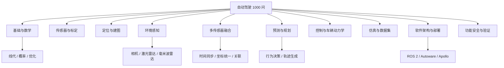

# 自动驾驶 1000 问：知识地图与问题清单

> 用问题驱动学习，而不是只收藏资料。当前先建立第一批可持续扩展的问题索引；每题后续应补充原理、公式/图示、工程案例、实验验证和参考来源。问题编号用于导航，不代表知识优先级。

## 使用方法

1. 先读每个主题的“核心问题”，用自己的话回答。
2. 遇到不懂的问题，跳转到本仓库对应专题或官方资料。
3. 每次只深入 1–3 个问题，补充 Mermaid 图、代码或实验结果。
4. 以“能解释、能实现、能验证”为完成标准；涉及安全关键功能时，额外记录失效模式和验证边界。

## 主题地图



## 问题—文档—实验关联索引

建议按“问题 → 理论文档 → 最小实验 → 结果记录”的顺序学习。当前实验是简化模型，用于验证局部概念，并不等于完整自动驾驶系统。

| 问题范围 | 建议先查阅 | 可运行实验 / 验证入口 |
|---|---|---|
| 1–10：系统与数学基础 | [学习路线](learning-roadmap.md)、[资源导航](resources.md) | [坐标变换 LAB-002](../labs/python/coordinate_transform_2d.py)、[实验总览](../labs/README.md) |
| 11–20：传感器、标定与同步 | [数据集与评测](datasets-and-benchmarks.md)、[开源工程实践](open-source-projects.md) | [坐标变换 LAB-002](../labs/python/coordinate_transform_2d.py)、[时间同步 LAB-008](../labs/python/sensor_fusion_timing_covariance.py) |
| 21–30：定位与建图 | [论文与研究方向](papers-and-research.md)、[数据集与评测](datasets-and-benchmarks.md) | [Kalman Filter LAB-001](../labs/python/kalman_1d.py)；当前仓库尚无完整 SLAM 实现 |
| 31–40：环境感知 | [论文与研究方向](papers-and-research.md)、[资源导航](resources.md) | [数据集与评测协议](datasets-and-benchmarks.md)；当前基础实验不包含深度学习检测器 |
| 41–50：多传感器融合 | [融合研究主题](papers-and-research.md)、[数据集与评测](datasets-and-benchmarks.md) | [基础融合 LAB-003](../labs/python/sensor_fusion_1d.py)、[鲁棒融合 LAB-005](../labs/python/sensor_fusion_robust.py)、[时间与协方差 LAB-008](../labs/python/sensor_fusion_timing_covariance.py) |
| 51–60：预测与规划 | [论文与研究方向](papers-and-research.md)、[CommonRoad 资源](resources.md) | [CARLA 复现指南](carla-reproducibility.md)；当前无独立轨迹预测模型实验 |
| 61–70：控制与车辆动力学 | [学习路线](learning-roadmap.md)、[开源工程实践](open-source-projects.md) | [Pure Pursuit LAB-004](../labs/python/pure_pursuit.py)、[参数扫描 LAB-007](../labs/python/pure_pursuit_sweep.py) |
| 71–80：数据集、仿真与评测 | [数据集与评测基准](datasets-and-benchmarks.md)、[CARLA 复现指南](carla-reproducibility.md) | [场景模板](../labs/carla/scenario-template.yaml)、[实验记录模板](../labs/README.md) |
| 81–90：软件架构与部署 | [开源工程实践](open-source-projects.md)、[资源导航](resources.md) | 当前仓库提供概念与工程导航，尚无 ROS 2 / Autoware / Apollo 部署实验 |
| 91–100：安全与研究方法 | [论文与研究方向](papers-and-research.md)、[贡献规范](../CONTRIBUTING.md) | [CARLA 复现指南](carla-reproducibility.md)、[CI 工作流](../.github/workflows/python-labs.yml) |
| 101–150：调试、数据质量与复现 | [CARLA 复现指南](carla-reproducibility.md)、[数据集与评测](datasets-and-benchmarks.md) | [全部实验与测试命令](../labs/README.md)；优先保留失败样例并记录配置版本 |


注意：关联到某个实验表示它能帮助理解局部原理，不代表它已经覆盖该问题的全部工程复杂度。特别是感知网络、SLAM、完整规划器和功能安全流程，仍需结合相应项目、数据集、标准及专门验证。

## 01. 基础知识与数学

1. 自动驾驶系统通常由哪些子系统组成？
2. 感知、预测、规划、控制之间如何传递信息？
3. 为什么坐标系是自动驾驶算法的基础？
4. 世界坐标系、车辆坐标系、传感器坐标系有什么区别？
5. 齐次坐标和 4×4 变换矩阵解决了什么问题？
6. 旋转矩阵、欧拉角和四元数各有什么优缺点？
7. 如何判断两个坐标系之间变换的方向？
8. 概率分布和贝叶斯公式如何用于状态估计？
9. 最小二乘、加权最小二乘和鲁棒估计有什么区别？
10. 如何为算法设计可复现的实验与评价指标？

## 02. 传感器、标定与同步

11. 相机、激光雷达、毫米波雷达和 GNSS/IMU 分别擅长什么？
12. 相机内参和外参分别描述什么？
13. 为什么传感器外参误差会导致融合目标错位？
14. 什么是手眼标定，自动驾驶中哪些场景会用到？
15. 时间戳、采样频率和传输延迟有什么区别？
16. 多传感器时间不同步会造成哪些典型故障？
17. rolling shutter 对运动目标有什么影响？
18. 激光雷达点云为什么需要去畸变？
19. 如何检查标定结果是否可信？
20. 标定文件变更后，应该回归哪些下游模块？

## 03. 定位与建图

21. GNSS 在城市峡谷和隧道中为什么容易失效？
22. IMU 的偏置和随机噪声如何影响积分结果？
23. 轮速里程计、视觉里程计和激光里程计如何互补？
24. 什么是 SLAM，定位与建图为何相互耦合？
25. 点云配准中的 ICP 在优化什么目标？
26. NDT 与 ICP 的基本思路有什么不同？
27. 回环检测如何减少累计漂移？
28. 地图定位与无地图定位各有什么约束？
29. 如何评价定位精度、稳定性和可用性？
30. 定位置信度下降时，规划控制应如何降级？

## 04. 环境感知

31. 2D 检测与 3D 检测的输出和难点有何不同？
32. IoU、Precision、Recall、AP 分别衡量什么？
33. NMS 为什么可能抑制相邻目标？
34. 点云稀疏性如何影响远距离目标检测？
35. BEV 表示为何适合多传感器感知？
36. Anchor-based 与 anchor-free 检测有什么区别？
37. 语义分割、实例分割和全景分割分别解决什么问题？
38. 遮挡、逆光、雨雾和夜间会怎样影响感知？
39. 感知模型的置信度是否等于真实正确概率？
40. 如何设计面向长尾场景的感知测试集？

## 05. 多传感器融合

41. 为什么需要多传感器融合，而不是只依赖单一传感器？
42. 数据级、特征级和目标级融合有何差异？
43. 早期融合与晚期融合分别适合什么情况？
44. 相机与激光雷达融合前需要完成哪些对齐？
45. 毫米波雷达的径向速度如何补充视觉信息？
46. 如何进行跨传感器目标关联？
47. Kalman Filter 的预测与更新步骤分别做什么？
48. EKF 为什么需要线性化，线性化有什么风险？
49. 如何处理传感器置信度不一致或观测冲突？
50. 如何通过消融实验判断融合模块是否真正有效？

## 06. 行为预测与规划

51. 轨迹预测与路径规划有什么区别？
52. 为什么预测结果通常需要表达多模态不确定性？
53. 如何预测行人、车辆和骑行者的未来行为？
54. 行为决策、路径规划和速度规划如何分层？
55. Frenet 坐标系在道路轨迹规划中有什么用途？
56. A*、Dijkstra 与 Hybrid A* 的区别是什么？
57. 采样式规划与优化式规划各有什么优缺点？
58. 轨迹平滑性、舒适性和可行性如何权衡？
59. 如何把交通规则转化为规划约束？
60. 如何验证规划器在无保护左转、并线和避障场景中的行为？

## 07. 控制与车辆动力学

61. 车辆运动学模型和动力学模型有何区别？
62. 轴距、转向比和轮胎侧偏会如何影响控制？
63. PID 控制的比例、积分、微分项分别起什么作用？
64. Pure Pursuit 的前视距离如何影响跟踪效果？
65. Stanley 控制如何利用横向误差和航向误差？
66. MPC 为什么适合处理多约束轨迹跟踪？
67. 纵向控制如何协调加速度、制动和舒适性？
68. 执行器延迟和饱和会如何影响闭环稳定性？
69. 如何设计控制器的稳定性与鲁棒性测试？
70. 仿真中的车辆模型与实车不一致时如何分析？

## 08. 数据集、仿真与评测

71. KITTI、nuScenes、Waymo Open Dataset 的主要差异是什么？
72. 数据集的训练、验证、测试集为什么必须隔离？
73. 数据分布偏差会如何误导模型评价？
74. 开放环评测和闭环评测有什么不同？
75. CARLA 中如何复现同一场景与随机种子？
76. 什么是场景覆盖率，如何构建场景矩阵？
77. CommonRoad 适合研究哪类规划问题？
78. nuPlan 的规划评测关注哪些维度？
79. 仿真通过是否意味着真实道路安全？
80. 如何记录软件版本、参数、数据和模型以复现实验？

## 09. 软件架构、部署与工程集成

81. ROS 2 的 Topic、Service 和 Action 分别适合什么交互？
82. QoS 不匹配会导致什么现象？
83. TF 树如何表达车辆与传感器之间的坐标关系？
84. 感知模块的输入输出接口应该如何定义？
85. 如何管理传感器数据的时间戳和消息队列？
86. Autoware 与 Apollo 的定位、感知、规划模块如何组织？
87. 模型从训练环境部署到车端需要经历哪些步骤？
88. 延迟、吞吐量、内存和算力如何共同影响实时性？
89. 模块故障如何传播，系统如何检测和隔离故障？
90. 如何设计日志、指标、回放与问题复现流程？

## 10. 安全、验证与前沿方向

91. 功能安全、预期功能安全和一般软件质量有何区别？
92. SOTIF 关注哪些由功能局限引起的风险？
93. 如何从危险分析推导安全目标和验证场景？
94. 什么是场景驱动测试，如何管理场景参数？
95. 为什么需要 SIL、HIL 和实车测试的分层验证？
96. 如何评估端到端自动驾驶模型的可解释性和鲁棒性？
97. 模仿学习与强化学习分别面临哪些数据和安全挑战？
98. 世界模型在自动驾驶研究中希望解决什么问题？
99. 如何识别论文中的数据泄漏、基线不公平或评价偏差？
100. 怎样将一个研究想法变成可复现、可比较的工程实验？

## 11. 工程调试、数据质量与实验复现（101–150）

101. 如何从一次自动驾驶故障中区分感知、定位、规划、控制和执行器问题？
102. 怎样为每条模块消息定义时间戳、坐标系、单位和有效期？
103. 如何识别传感器数据积压造成的“旧数据看起来正常”问题？
104. 数据记录、在线回放和离线回放之间有哪些语义差异？
105. 为什么日志必须同时记录输入、输出、配置版本和时间基准？
106. 如何用最小复现数据集缩小复杂故障的排查范围？
107. 如何设计模块级单元测试、接口测试和系统级回归测试？
108. 哪些算法行为适合使用属性测试（property-based testing）验证？
109. 如何构造数值边界、空输入、NaN、无穷值和异常时间戳测试？
110. 如何避免测试只验证“程序不崩溃”，却没有验证算法正确性？

111. 传感器时钟偏差、传输延迟和采样抖动如何区分？
112. 时间同步误差会如何转换成空间位置误差？
113. 传感器外参的小角度误差会怎样影响远距离目标投影？
114. 如何验证坐标变换的方向、逆变换和矩阵组合顺序？
115. 如何设计坐标变换的往返一致性测试？
116. 当两个传感器观测不一致时，怎样判断是噪声、延迟还是关联错误？
117. 如何估计测量噪声方差，避免凭经验随意指定权重？
118. 观测噪声相关时，直接逆方差加权会产生什么问题？
119. 中位数、MAD、门限剔除和 Huber 损失分别适合哪些异常情况？
120. 为什么异常值门限必须同时考虑传感器不确定性与场景条件？

121. 如何为目标跟踪定义 ID 切换、轨迹中断和延迟等指标？
122. MOTA、MOTP、HOTA 等跟踪指标各自强调什么？
123. 如何区分检测漏检、关联错误和跟踪器状态发散？
124. 轨迹预测的 minADE、minFDE 与概率校准各说明什么？
125. 为什么规划评测不能只看平均轨迹误差？
126. 如何定义横向误差、航向误差、曲率和速度误差的统计窗口？
127. 控制器的前视距离、速度、轴距和转向限幅之间有什么关系？
128. 如何识别低速时稳定、高速时振荡的轨迹跟踪问题？
129. 如何把执行器延迟和转向速率限制纳入离线控制仿真？
130. 为什么控制器仿真应同时保留直线、弯道、变曲率和扰动场景？

131. 如何为 CARLA 场景定义明确的成功、失败和超时条件？
132. 固定随机种子为什么仍可能无法保证跨版本完全确定性？
133. 如何避免把地图、天气、交通流和算法参数同时改变？
134. 什么是场景参数覆盖率，如何识别未覆盖的组合？
135. 如何报告重复实验的均值、分位数、方差与置信区间？
136. 如何区分算法退化、随机波动和仿真环境变化？
137. 为什么场景回归集要保留历史失败案例，而不是只保留成功案例？
138. 开放环回放与闭环仿真对系统行为的检验有何不同？
139. 如何验证仿真中的传感器噪声和遮挡是否具有代表性？
140. 仿真指标怎样与真实道路数据建立可解释的关联，而不是简单等同？

141. 如何记录模型权重、预处理代码、数据版本和推理配置的对应关系？
142. 模型量化、剪枝和不同推理后端会引入哪些数值差异？
143. 如何分析感知模型在雨雾、逆光、夜间和长尾目标上的分层性能？
144. 数据集划分如何防止同一路段、同一车辆或相邻帧造成泄漏？
145. 如何为模型性能建立延迟、吞吐量、内存与精度的联合基准？
146. 如何区分功能安全、预期功能安全、网络安全与一般软件可靠性问题？
147. 故障检测、故障隔离和最小风险状态分别承担什么职责？
148. 如何将危险分析结果转化为可执行的场景测试和验收条件？
149. 一篇论文的指标提升可能来自哪些数据、训练或评价协议差异？
150. 如何把一个研究结论变成独立可运行、可复查、可比较的实验？

## 单题笔记模板

```markdown
## 问题：为什么需要多传感器融合？

### 一句话回答
用自己的话给出结论。

### 原理与边界
解释关键假设、适用条件、失效场景。

### 系统关系
输入 → 处理 → 输出；必要时补 Mermaid 图。

### 工程案例
记录真实问题、日志现象、排查过程和结论。

### 实验验证
- 数据与版本：
- 对照基线：
- 指标：
- 结果：
- 局限：

### 参考来源
优先官方文档、论文原文、可复现代码。
### 关联问题
用双向链接或仓库相对路径关联其他问题。
```

## 质量规则

- 不把论文标题当作结论；记录方法、假设、数据集、指标和限制。
- 不把仿真指标直接等同于道路安全。
- 不复制未经核实的“最新论文”列表；每次更新标注核验日期。
- 后续扩充至 1000 问时按主题分文件，避免单文件过长；本页作为总索引。
