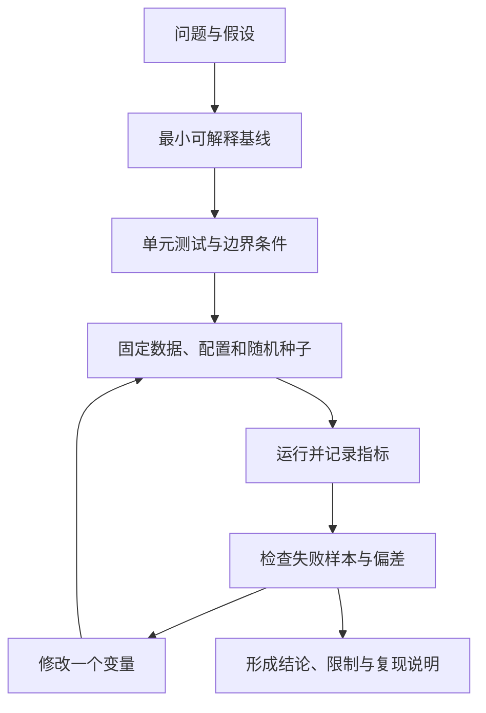

# 自动驾驶核心算法手册

> 面向从原理学习到可复现实验的读者。本文给出算法的最小心智模型、常用公式、代码入口与评测提醒；公式和示例用于学习，不等同于经过安全认证的车辆软件。

## 1. 从问题到算法：先明确输入、输出和约束

| 子系统 | 典型输入 | 典型输出 | 常见误区 |
|---|---|---|---|
| 感知 | 图像、点云、雷达目标 | 类别、位置、尺寸、置信度 | 只看 mAP，不检查距离、遮挡和长尾场景 |
| 定位 | GNSS、IMU、轮速、LiDAR/视觉特征 | 位姿、速度、不确定度 | 忽略坐标系、时间戳和漂移 |
| 跟踪 | 检测结果、历史轨迹 | 稳定 ID、状态估计 | 把检测精度等同于跟踪质量 |
| 预测 | 目标状态、地图、交互上下文 | 多条未来轨迹及概率 | 只评估平均误差，不看碰撞风险和多模态 |
| 规划 | 自车状态、道路、障碍物、规则 | 可行驶路径或轨迹 | 只追求平滑，忽略可行性与安全边界 |
| 控制 | 参考轨迹、车辆状态 | 转向、加减速指令 | 忽略执行器限制、延迟和模型误差 |

建议每次实现前写下：坐标系与单位、采样周期、输入有效性、输出含义、失败处理、基线算法、评价指标。

## 2. 坐标变换：先约定方向，再计算矩阵

齐次变换常写为：

\[
\mathbf{p}_A = \mathbf{T}_{A\leftarrow B}\mathbf{p}_B,\qquad
\mathbf{T}_{A\leftarrow B}=
\begin{bmatrix}\mathbf{R}_{A\leftarrow B}&\mathbf{t}_{A\leftarrow B}\\0&1\end{bmatrix}
\]

这里的下标表示“把 B 坐标系中的点转换到 A 坐标系”。若点要从 C 转到 A，且已知 B←C 与 A←B：

\[
\mathbf{T}_{A\leftarrow C}=\mathbf{T}_{A\leftarrow B}\mathbf{T}_{B\leftarrow C}
\]

检查清单：
- 旋转矩阵是否正交，行列式是否接近 +1。
- 平移量是否使用一致的长度单位。
- 欧拉角的旋转顺序、左右手系和角度单位是否明确。
- 使用点（齐次坐标末位为 1）还是方向向量（末位为 0）。
- 用正变换再逆变换验证恢复误差。

实验入口：[二维坐标变换](../labs/python/coordinate_transform_2d.py)。

## 3. Kalman Filter：预测与观测更新

线性系统：

\[
\mathbf{x}_k=\mathbf{F}_k\mathbf{x}_{k-1}+\mathbf{w}_k,\quad
\mathbf{z}_k=\mathbf{H}_k\mathbf{x}_k+\mathbf{v}_k
\]

预测：
\[
\hat{\mathbf{x}}^-_k=\mathbf{F}_k\hat{\mathbf{x}}_{k-1},\quad
\mathbf{P}^-_k=\mathbf{F}_k\mathbf{P}_{k-1}\mathbf{F}_k^T+\mathbf{Q}_k
\]

更新：
\[
\mathbf{K}_k=\mathbf{P}^-_k\mathbf{H}_k^T(\mathbf{H}_k\mathbf{P}^-_k\mathbf{H}_k^T+\mathbf{R}_k)^{-1}
\]
\[
\hat{\mathbf{x}}_k=\hat{\mathbf{x}}^-_k+\mathbf{K}_k(\mathbf{z}_k-\mathbf{H}_k\hat{\mathbf{x}}^-_k)
\]

直觉：预测依赖运动模型，更新依赖传感器观测；Q 描述模型不确定度，R 描述观测噪声。Q/R 不是随意调到“曲线好看”，而应与真实误差统计和采样周期一致。

实验入口：[一维匀速 Kalman Filter](../labs/python/kalman_1d.py)。当前实验是合成数据的教学模型，不是车辆定位方案。

## 4. 传感器融合：加权平均只是一个受限基线

对同一个标量状态，若观测无偏、相互独立，方差为 \(\sigma_i^2\)，则逆方差权重为：

\[
w_i=\frac{1/\sigma_i^2}{\sum_j1/\sigma_j^2},\qquad
\hat{x}=\sum_iw_ix_i
\]

适用前提包括：观测已对齐到同一坐标系和时刻、对应同一对象、噪声方差有合理依据。真实融合还需要数据关联、时序对齐、外参标定、异常值处理以及相关噪声建模。

学习顺序：
1. [独立观测的加权融合](../labs/python/sensor_fusion_1d.py)
2. [异常值门控](../labs/python/sensor_fusion_robust.py)
3. [时间同步与相关噪声](../labs/python/sensor_fusion_timing_covariance.py)

## 5. 2D 检测框：IoU 与 NMS

交并比（Intersection over Union）：

\[
\operatorname{IoU}(A,B)=\frac{|A\cap B|}{|A\cup B|}
\]

IoU 常用于匹配预测框与真值框，也常作为非极大值抑制（NMS）的重叠度度量。标准贪心 NMS 的基本步骤：
1. 按置信度从高到低排序。
2. 选择最高分框并保留。
3. 删除与该框 IoU 大于阈值的候选框。
4. 重复直到候选为空。

阈值是任务相关的超参数；遮挡、密集目标、类别差异都会影响行为。NMS 的阈值不等于检测模型的置信度阈值。仓库实验：[IoU 与 NMS 最小实现](../labs/python/iou_nms.py)。

## 6. 数据关联与多目标跟踪

经典跟踪管线可拆为：
- **预测**：根据上一时刻状态预测当前状态。
- **候选匹配**：计算检测与轨迹间的代价（位置、IoU、外观等）。
- **分配**：通过匈牙利算法等方法求解匹配问题。
- **更新**：用匹配观测更新轨迹状态。
- **生命周期管理**：处理新生、暂失、删除和重新出现的目标。

常见错误是只用欧氏距离匹配，未考虑类别、运动不确定度、遮挡和时间间隔。评估时同时关注检测质量、身份切换、漏跟踪和轨迹连续性；不同 benchmark 的指标与协议不可直接混用。

## 7. 路径跟踪：Pure Pursuit 的几何关系

把目标点转换到车辆坐标系后，设其局部坐标为 \((x_L,y_L)\)，距离平方为 \(L_d^2=x_L^2+y_L^2\)，则：

\[
\kappa=\frac{2y_L}{L_d^2},\qquad
\delta=\arctan(L\kappa)
\]

其中 \(\kappa\) 为曲率，\(L\) 为轴距，\(\delta\) 为前轮转角。前视距离会影响响应与平滑性：过小可能导致控制抖动，过大可能切弯。实际系统还要考虑转角/转角速度限制、车辆动力学、速度规划、延迟和道路边界。

实验入口：[Pure Pursuit](../labs/python/pure_pursuit.py) 与 [前视距离扫描](../labs/python/pure_pursuit_sweep.py)。

## 8. 规划算法：按问题结构选择基线

| 算法 | 适用的学习场景 | 主要代价或目标 | 需要验证的约束 |
|---|---|---|---|
| BFS / Dijkstra | 离散无权/非负权图搜索 | 路径长度或累计代价 | 图连通性、权重定义 |
| A* | 有启发式的图搜索 | 累计代价 + 启发式估计 | 启发式是否可采纳/一致 |
| Frenet 采样 | 道路参考线附近的候选轨迹 | 舒适性、偏离、风险等组合代价 | 车辆可行性、碰撞、道路边界 |
| 优化式轨迹规划 | 有明确动力学与约束的连续问题 | 目标函数最小化 | 可行性、收敛性、约束违例 |
| 速度规划 | 沿路径安排速度曲线 | 时间、舒适性、风险 | 加速度、加加速度、限速与停车距离 |

先实现可解释的基线，再逐项增加约束；不要仅凭单一代价函数的数值判断方案更安全。

## 9. 评估指标：先写协议，再比较数字

| 任务 | 常见指标 | 报告必须交代 |
|---|---|---|
| 2D/3D 检测 | AP、mAP、按距离/类别分组的 AP | IoU 阈值、类别映射、评测脚本版本 |
| 跟踪 | HOTA、IDF1、MOTA 等 | 匹配协议、忽略区域、序列切分 |
| 轨迹预测 | ADE、FDE、minADE/minFDE、概率相关指标 | 预测时域、候选数、是否使用未来信息 |
| 定位 | ATE、RPE | 轨迹对齐方法、单位、序列选择 |
| 控制/规划 | 横向误差、碰撞率、越界率、规则违反、舒适性 | 场景分布、仿真版本、随机种子、终止条件 |
| 系统性能 | 延迟、吞吐、CPU/GPU/内存占用 | 硬件、热身、批大小、统计口径 |

不能跨数据集、跨版本或跨评测协议直接比较数字。至少报告样本数、均值与分布、失败案例和可复现命令。

## 10. 建议的学习闭环

## 参考入口

- [知识覆盖矩阵](coverage-matrix.md)
- [学习路线](learning-roadmap.md)
- [开源项目实践](open-source-projects.md)
- [论文与研究方向](papers-and-research.md)
- [数据集与评测选型](dataset-selection-matrix.md)
- [工程实践手册](engineering-playbook.md)
- [可运行实验目录](../labs/README.md)

## 维护约定

每个新算法主题尽量包含：问题定义、输入/输出、关键公式、最小代码、单元测试、指标协议、失败案例、适用边界和可信参考来源。没有运行过的代码或实验必须明确标记为待验证。
