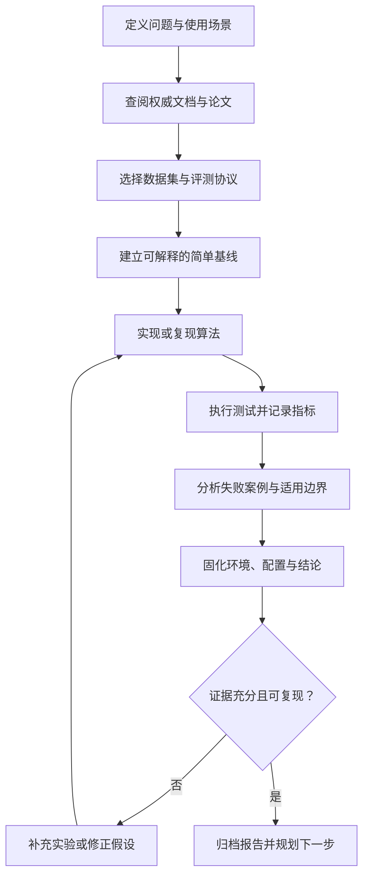

# 自动驾驶知识覆盖矩阵

> 本矩阵用于检查学习内容是否覆盖从基础算法到系统验证的关键环节。它是持续维护的学习目录，不代表各项技术均已在真实车辆或本仓库环境中完成验证。

## 1. 知识领域与阶段性成果

| 领域 | 核心知识 | 建议实践成果 | 相关资料 |
|---|---|---|---|
| 编程与工具链 | Python、C++、Linux、Git、调试、构建系统 | 可复现的项目环境与最小示例 | [学习路线](learning-roadmap.md) |
| 数学与几何 | 线性代数、概率统计、优化、旋转与坐标变换 | 二维/三维坐标变换单元测试 | [实验目录](../labs/README.md) |
| 车辆模型 | 运动学自行车模型、动力学基础、执行器限制 | 车辆状态更新与模型误差记录 | [工程实践手册](engineering-playbook.md) |
| 传感器基础 | 相机、LiDAR、毫米波雷达、GNSS、IMU、轮速 | 传感器参数、单位、时间戳和坐标系表 | [资源导航](resources.md) |
| 标定与同步 | 相机内参、传感器外参、时钟偏差、运动补偿 | 外参检查脚本和同步误差报告 | [工程实践手册](engineering-playbook.md) |
| 计算机视觉 | 图像预处理、检测、分割、深度估计 | 在公开样例上运行并记录评测 | [资源导航](resources.md) |
| 点云处理 | 点云过滤、地面分割、聚类、3D 检测 | 点云可视化与误差案例集 | [开源项目实践](open-source-projects.md) |
| 传感器融合 | 数据/特征/目标级融合、关联、滤波、不确定度 | 比较单传感器与融合基线 | [融合实验](../labs/python/sensor_fusion_1d.py) |
| 跟踪与预测 | 状态估计、数据关联、多目标跟踪、多模态预测 | 轨迹可视化及 ADE/FDE 等指标报告 | [数据集选型](dataset-selection-matrix.md) |
| 定位与建图 | GNSS/IMU、里程计、SLAM、地图匹配 | 轨迹误差与失效场景分析 | [资源导航](resources.md) |
| 地图与道路语义 | 车道拓扑、Lanelet2、OpenDRIVE | 将道路约束可视化并校验坐标系 | [资源导航](resources.md) |
| 行为决策 | 状态机、规则策略、交互与风险评估 | 构造交叉口、让行等场景测试 | [开源项目实践](open-source-projects.md) |
| 路径与轨迹规划 | 图搜索、采样规划、优化、碰撞约束 | 对比路径可行性、平滑性和耗时 | [工程实践手册](engineering-playbook.md) |
| 车辆控制 | PID、Pure Pursuit、Stanley、LQR、MPC | 记录横向误差、控制量和延迟 | [Pure Pursuit 实验](../labs/python/pure_pursuit.py) |
| ROS 2 与系统集成 | Nodes、Topics、TF2、QoS、rosbag、生命周期 | 节点图、消息契约与回放记录 | [开源项目实践](open-source-projects.md) |
| 仿真与场景 | CARLA、场景描述、交通参与者、随机种子 | 可重复场景配置和运行记录 | [CARLA 指南](carla-reproducibility.md) |
| 评测与数据治理 | 数据切分、指标、许可、偏差、长尾分析 | 数据卡、基线结果和失败样本清单 | [数据集矩阵](dataset-selection-matrix.md) |
| 软件质量 | 单元测试、集成测试、回归、CI、日志 | 自动化测试与故障复现用例 | [实验目录](../labs/README.md) |
| 安全与可靠性 | 故障检测、降级策略、急停、危害分析 | 风险清单与安全边界说明 | [工程实践手册](engineering-playbook.md) |
| 端到端与基础模型 | 模仿学习、BEV、Transformer、多模态驾驶推理 | 复现一个公开基线并记录限制 | [研究方向](papers-and-research.md) |

## 2. 建议的学习闭环

## 3. 每个主题的最低交付标准

- [ ] 有明确的问题定义、术语解释和输入/输出说明。
- [ ] 说明数据单位、坐标系、时间戳与关键假设。
- [ ] 链接到官方文档、原始论文或可信的项目主页。
- [ ] 提供至少一个可执行的学习任务或代码阅读入口。
- [ ] 定义与任务相匹配的评估指标及其计算协议。
- [ ] 记录失败案例、边界条件和已知限制。
- [ ] 区分已实际运行的内容与仅供参考的外部链接。
- [ ] 检查代码、模型、数据集和图片的许可证及归属。

## 4. 数据集与任务的对应关系

| 任务 | 可优先调研的数据集 | 评估注意事项 |
|---|---|---|
| 2D 检测与场景理解 | BDD100K、Cityscapes、nuImages | 类别定义、昼夜与天气分布、数据切分 |
| 多传感器 3D 检测 | nuScenes、Waymo Open Dataset、Argoverse 2 Sensor | 标定、采样频率、类别映射与评测脚本 |
| 点云语义分割 | SemanticKITTI、nuScenes lidarseg | 点级标签、类别不平衡与序列划分 |
| 运动预测 | Waymo Motion、Argoverse 2 Motion、nuScenes Prediction | 预测时域、候选轨迹数、概率校准 |
| 车路协同 | DAIR-V2X、V2X-Seq | 坐标对齐、通信延迟和传感器差异 |
| 定位与 SLAM | KITTI Odometry、Oxford RobotCar、MulRan | 轨迹对齐、环境变化与传感器配置 |
| 规划评估 | nuPlan、CommonRoad | 闭环/离线差异、规则违反、可行性与舒适性 |

数据集入口和具体条款请以[数据集选型与评测矩阵](dataset-selection-matrix.md)及各数据集官网为准。

## 5. 维护原则

1. 优先保留官方项目、论文作者仓库、数据集官网和标准组织链接。
2. 为关键项目补充用途、先决条件、运行入口和维护状态提示。
3. 不将 GitHub 星标数或单一 benchmark 排名视为质量的唯一依据。
4. 新增代码必须提供运行方式与相应测试；无法验证时应明确标记。
5. 定期检查链接、相互依赖的版本和重复条目，避免把“资源数量”误当成“内容完整度”。
