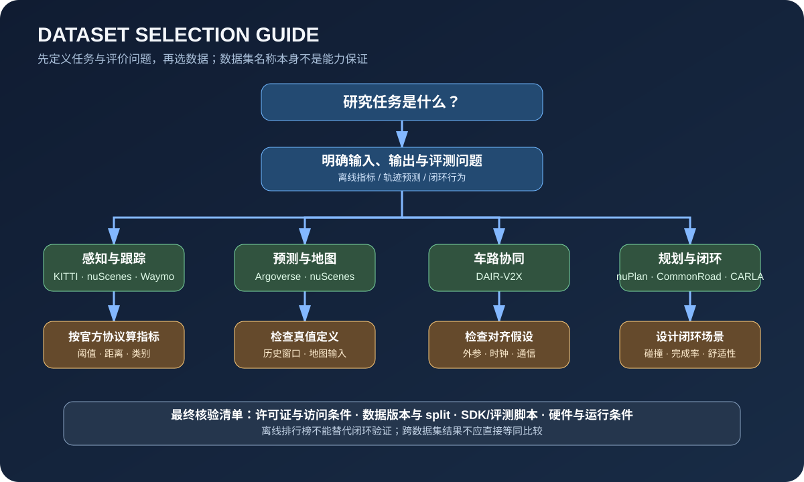
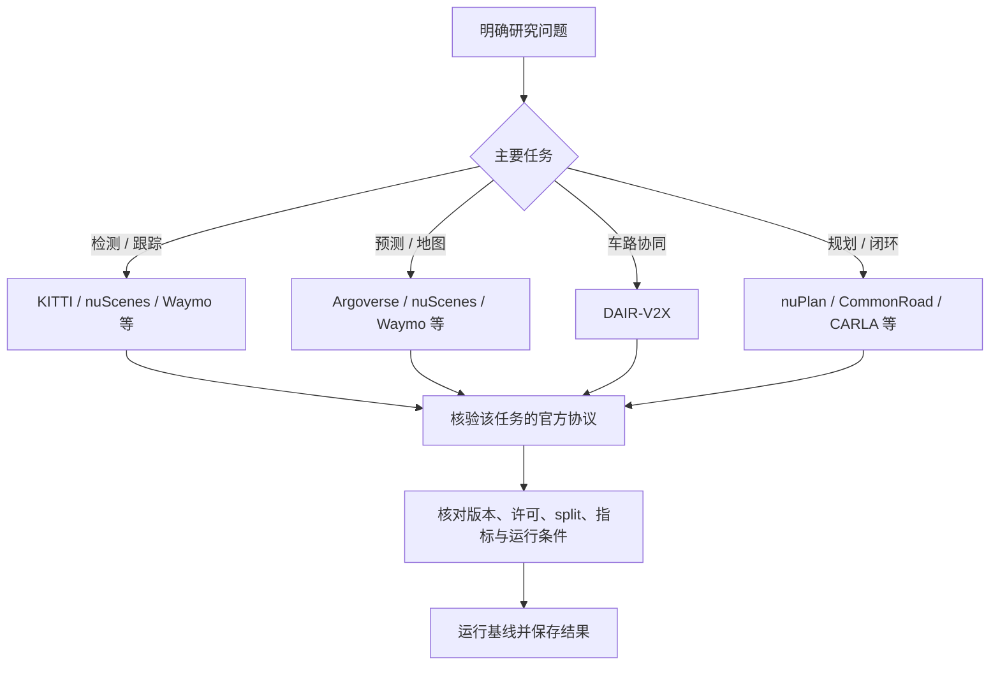

# 自动驾驶数据集与评测基准

数据集适合研究不同问题，不能简单用一个排行榜覆盖所有能力。下载前请阅读官网许可、注册要求、隐私与使用条款；不要将数据集默认视为可自由再分发或可商用。

## 数据集索引

| 数据集 | 主要方向 | 官方入口 | 使用前检查 |
|---|---|---|---|
| KITTI | 立体视觉、光流、视觉里程计、3D 检测 | [官网](https://www.cvlibs.net/datasets/kitti/) | 不同子集任务、评测协议和许可可能不同 |
| nuScenes | 多传感器感知、3D 检测、跟踪、预测 | [官网](https://www.nuscenes.org/) | SDK 版本、数据拆分、指标和许可 |
| Waymo Open Dataset | 大规模感知、运动和场景研究 | [官网](https://waymo.com/open/) | 下载条款、任务版本、计算与提交要求 |
| Argoverse | 感知、地图、运动预测 | [官网](https://www.argoverse.org/) | 数据集版本和工具包兼容性 |
| BDD100K | 驾驶视频、2D 感知、车道和场景属性 | [官网](https://www.vis.xyz/bdd100k/) | 标注任务和子集定义 |
| DAIR-V2X | 车端/路侧协同感知 | [官网](https://thudair.baai.ac.cn/) | 数据使用协议、坐标标定和模态定义 |
| Oxford RobotCar | 长期、多天气道路场景与定位 | [官网](https://robotcar-dataset.robots.ox.ac.uk/) | 下载权限、传感器和采集条件 |
| nuPlan | 规划与闭环评测 | [项目](https://github.com/motional/nuplan-devkit) | 版本、数据访问和评测配置 |
| CommonRoad | 运动规划场景与可行性研究 | [官网](https://commonroad.in.tum.de/) | 场景格式、车辆模型和评价规则 |

## 如何选择数据集

- **初学感知**：从 KITTI 的一个明确任务开始，先完成数据读取、标注可视化和基线评测。
- **多传感器融合**：选择 nuScenes 或 Waymo 的适用任务，核对传感器时间戳、外参和标注坐标系。
- **运动预测**：查看 Argoverse、nuScenes 或 Waymo 中的预测任务，注意历史轨迹、地图信息和未来真值定义。
- **车路协同**：查看 DAIR-V2X，重点理解车端/路侧坐标对齐和通信假设。
- **规划与闭环**：结合 nuPlan、CommonRoad 或 CARLA 场景，不要只依赖离线轨迹误差。

## 评测指标：先问清楚指标衡量什么

| 任务 | 常见指标 | 需要补充的分析 |
|---|---|---|
| 2D/3D 检测 | AP、mAP、IoU 阈值下的精度 | 距离、遮挡、类别、目标尺寸分层 |
| 多目标跟踪 | MOTA、IDF1、HOTA 等 | ID 切换、漏跟踪和轨迹稳定性 |
| 运动预测 | minADE、minFDE、Miss Rate 等 | 多模态预测、校准与长尾场景 |
| 定位 | 平移/旋转误差、ATE/RPE | 失锁、漂移、初始化和场景退化 |
| 规划/驾驶 | 碰撞率、完成率、路线偏离等 | 场景覆盖、舒适性、交通规则与闭环稳定性 |
| 运行效率 | 延迟、吞吐量、资源占用 | 硬件、批大小、预处理和端到端测量边界 |

指标名称相同不代表评测方式相同。比较结果时必须记录官方协议、数据拆分、阈值和模型推理条件。

## 数据集实验记录

- 数据集名称、版本、下载日期和许可证
- 官方文档与 SDK 版本
- 训练/验证/测试拆分
- 标注格式、坐标系、时间同步方式
- 预处理步骤与配置文件
- 基线模型和评测命令
- 指标结果、硬件与运行时间
- 错误样本分类和已知偏差

## 数据集选择决策图

  

上述数据集仅是候选入口，不代表每个数据集都包含所有列出的任务，也不意味着任务间可以直接比较。请以对应版本的官方任务说明和评测脚本为准。

## 指标对照与常见误读

| 研究任务 | 指标例子 | 解释时要补充的条件 |
|---|---|---|
| 2D/3D 检测 | AP、mAP | IoU 阈值、距离范围、类别与难度分层 |
| 跟踪 | MOTA、IDF1、HOTA | 匹配规则、遮挡处理、轨迹连续性与 ID 切换 |
| 运动预测 | minADE、minFDE、Miss Rate | 预测时域、候选轨迹数量、真值定义与 miss 阈值 |
| 定位 / 里程计 | ATE、RPE、平移/旋转误差 | 对齐方式、初始化、坐标系与轨迹区间 |
| 规划 / 驾驶 | 碰撞率、完成率、路线偏离、舒适性相关指标 | 场景集、交通规则、仿真器版本与闭环执行条件 |
| 系统性能 | 延迟、吞吐量、峰值内存 | 硬件、批大小、预处理范围、同步/异步测量方式 |

不要把指标缩写当作完整定义：同名指标可能存在不同实现和聚合方式。报告结果时，最好同时给出评测脚本版本、配置文件、数据拆分、运行环境和失败样本分析。
