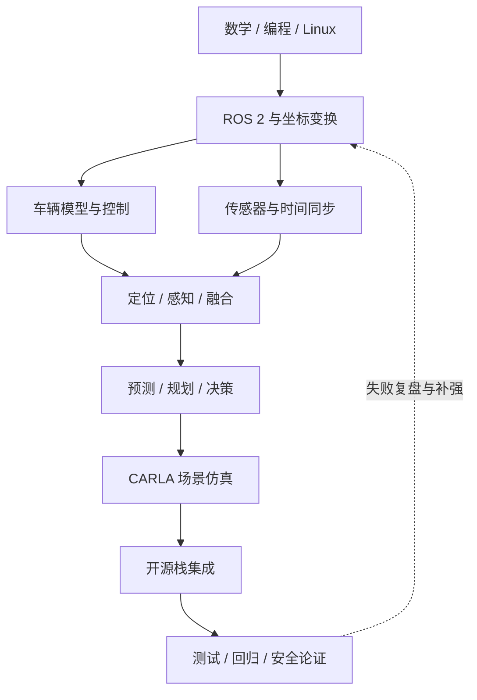

# 自动驾驶系统学习路线

  

## 全局路线图

下图展示学习阶段之间的主线关系。实际学习时可以按项目需要迭代，不必等到完全掌握上一阶段才开始动手实践。

这条路线以「能解释系统、能运行代码、能设计实验」为目标。每阶段都应留下可复现的代码、笔记或实验记录。不要急于从大模型论文开始；数学、坐标系、数据处理和工程调试会反复用到。

## 阶段 0：开发基础

**学习内容**
- Python：NumPy、OpenCV、Matplotlib、数据读取与可视化。
- C++：现代 C++ 基础、内存与对象生命周期、模板、CMake、调试。
- Linux、Git、Docker 基础；了解 GPU/CUDA 的基本概念。
- 线性代数、概率统计、微积分、优化方法。

**实践任务**
- 读取一段视频并绘制目标/轨迹。
- 用 NumPy 实现坐标变换、向量投影和简单滤波。
- 为小型 C++ 程序编写 CMake 构建和单元测试。

## 阶段 1：机器人基础与 ROS 2

**学习内容**
- ROS 2 节点、Topic、Service、Action、Parameter、Launch。
- 消息类型、QoS、TF2 坐标变换、rosbag、RViz。
- 时间戳、同步、坐标系命名和传感器外参的意义。

**实践任务**
- 编写发布/订阅节点，录制并回放 rosbag。
- 在 RViz 中显示车辆坐标系和传感器数据。
- 画出消息流图，并解释每个模块的输入、输出和频率。

官方教程：[ROS 2 Tutorials](https://docs.ros.org/en/rolling/Tutorials.html)。

## 阶段 2：车辆运动学、动力学与控制

**学习内容**
- 自行车运动学模型、车辆坐标系、转向角与曲率。
- PID、Pure Pursuit、Stanley、LQR、MPC 的基本思想。
- 轨迹表示、横纵向控制、执行器延迟与约束。

**实践任务**
- 实现运动学自行车模型。
- 对同一条参考轨迹比较 Pure Pursuit、Stanley 或 PID。
- 绘制横向误差、航向误差、控制量和速度随时间变化的曲线。

## 阶段 3：传感器、标定与定位

**学习内容**
- Camera、LiDAR、Radar、IMU、GNSS 的测量特点与局限。
- 相机内参/外参、LiDAR-camera 标定、时间同步。
- 坐标变换链、EKF/UKF、GNSS/INS 融合、SLAM 与地图匹配。

**实践任务**
- 将点云投影到相机图像并检查外参。
- 使用公开数据绘制车辆轨迹和定位误差。
- 对比单传感器定位与多传感器融合的失效场景。

## 阶段 4：感知与多传感器融合

**学习内容**
- 图像分类、检测、语义/实例分割与多目标跟踪。
- 点云表示、Voxel/Point-based 方法、3D 目标检测。
- BEV 表征、Camera-LiDAR 融合、雷达与视觉融合。
- 评测指标：Precision/Recall、mAP、NDS、跟踪指标等。

**实践任务**
- 在 KITTI 或 nuScenes 上运行一个基线模型。
- 记录数据划分、依赖版本、推理速度和评测指标。
- 设计遮挡、夜间、雨雾或传感器缺失的误差分析表。

推荐入口：[OpenPCDet](https://github.com/open-mmlab/OpenPCDet)、[MMDetection3D](https://github.com/open-mmlab/mmdetection3d)。

## 阶段 5：预测、规划与决策

**学习内容**
- 车辆/行人运动预测、轨迹预测和不确定性。
- 图搜索、采样规划、优化规划、行为决策。
- 道路拓扑、车道约束、碰撞检查和舒适性约束。

**实践任务**
- 实现 A* 或 Hybrid A* 的简化版本。
- 规划一条满足曲率或障碍物约束的轨迹。
- 分析预测误差如何影响规划结果，而不仅是单独看预测指标。

## 阶段 6：仿真与端到端实验

**学习内容**
- CARLA 场景、地图、车辆、传感器、Python API 与 ROS bridge。
- 场景复现、闭环评测、基于规则的基线和学习式策略。
- 模仿学习、强化学习、端到端驾驶与 VLA/VLM 的适用边界。

**实践任务**
- 在 CARLA 中运行一个可重复场景，保存配置和随机种子。
- 用固定路线比较两种策略的成功率、碰撞率、舒适性和完成时间。
- 将失败场景整理为回归测试，而不是只展示成功视频。

资源：[CARLA](https://github.com/carla-simulator/carla)、[CARLA 文档](https://carla.readthedocs.io/)。

## 阶段 7：开源自动驾驶栈与系统集成

选择一个栈深入，不要一开始同时部署多个大型系统：
- **Autoware**：ROS 2 生态、模块化系统、车辆/传感器接入与仿真。
- **Apollo**：模块化自动驾驶工程、开发工具和系统实践。

实践顺序建议：阅读架构 → 跑官方示例 → 查看消息/接口 → 单独调试一个模块 → 在仿真中验证 → 编写问题复盘。

## 阶段 8：工程验证与安全

- 建立需求、设计、实现、测试和证据之间的追踪关系。
- 关注场景覆盖、边界条件、故障注入、回归测试和运行监控。
- 了解 ISO 26262、ISO 21448（SOTIF）及相关法规的适用范围；正式项目应使用合法授权的标准文本。
- 不要将研究代码或仿真成功直接视为可上路的安全证明。

## 建议的学习记录模板

每次实验记录：
1. **问题与假设**：想验证什么？
2. **环境**：OS、GPU、驱动、框架/ROS 版本、commit。
3. **输入**：数据集版本、场景配置、参数、随机种子。
4. **步骤**：完整命令和关键配置。
5. **结果**：指标、日志、图表、运行耗时。
6. **失败分析**：现象、根因证据、修复与剩余风险。
7. **知识卡片**：一个核心结论、一个反例、相关概念链接。
