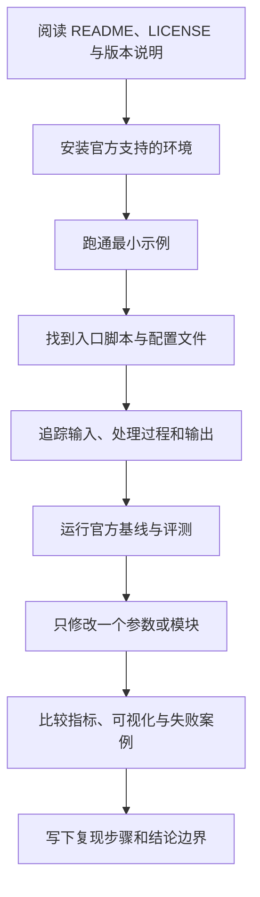

# 开源工程实践指南：从会用到读懂

这份指南帮助你把 GitHub 上的自动驾驶项目变成可执行的学习任务。建议每次只研究一个模块，先跑通官方示例，再追踪数据流，最后做可复现的小实验。

## 1. 按学习目标选项目

| 学习目标 | 推荐项目 | 第一个小任务 |
|---|---|---|
| 理解完整自动驾驶系统 | [Apollo](https://github.com/ApolloAuto/apollo)、[Autoware](https://github.com/autowarefoundation/autoware) | 画出模块图，说明感知、定位、规划、控制的输入输出 |
| 学习 ROS 2 通信 | [ROS 2](https://github.com/ros2/ros2)、[Autoware Universe](https://github.com/autowarefoundation/autoware_universe) | 找到一个 Topic，记录消息类型、频率和坐标系 |
| 驾驶仿真 | [CARLA](https://github.com/carla-simulator/carla) | 启动示例地图并读取一帧相机数据 |
| 场景测试 | [Scenario Runner](https://github.com/carla-simulator/scenario_runner)、[CommonRoad](https://github.com/CommonRoad) | 运行一个简单场景并记录成功/失败条件 |
| LiDAR 3D 检测 | [OpenPCDet](https://github.com/open-mmlab/OpenPCDet) | 跑通一个官方基线推理和评测 |
| 3D 检测框架 | [MMDetection3D](https://github.com/open-mmlab/mmdetection3d) | 理解一个数据集配置和模型配置 |
| 相机与 LiDAR 融合 | [BEVFusion](https://github.com/mit-han-lab/bevfusion) | 画出数据输入、坐标变换、融合与输出 |
| 端到端驾驶研究 | [UniAD](https://github.com/OpenDriveLab/UniAD)、[OpenDriveLab E2E](https://github.com/OpenDriveLab/End-to-end-Autonomous-Driving) | 先读论文总图，再定位一个任务对应的代码 |
| 驾驶场景语言推理 | [DriveLM](https://github.com/OpenDriveLab/DriveLM) | 阅读数据样本和任务定义 |
| 定位与 SLAM | [SLAM in Autonomous Driving](https://github.com/gaoxiang12/slam_in_autonomous_driving) | 先理解坐标系、里程计与误差指标 |
| 规划算法评估 | [nuPlan devkit](https://github.com/motional/nuplan-devkit) | 了解场景输入、规划器输出与评价指标 |
| 车辆软件工程案例 | [openpilot](https://github.com/commaai/openpilot) | 阅读项目架构、测试和接口边界，不连接真实车辆做未经授权的实验 |

这些项目规模、硬件要求、维护状态与许可证各不相同。列表是学习导航，不代表本仓库已经逐个安装、运行或验证。

## 2. 读大型仓库的正确顺序

不要一开始就尝试理解整个仓库。先回答三个问题：程序从哪里启动？数据从哪里来、经过哪些模块？结果怎样被评估？

## 3. 通用代码阅读清单

- [ ] README、官方文档、LICENSE 和版本要求已阅读
- [ ] 确认代码、模型权重和数据集分别适用什么许可
- [ ] 找到安装脚本、入口程序、配置文件和测试目录
- [ ] 记录输入输出的数据类型、单位、坐标系和时间戳
- [ ] 跑通官方最小示例，保存命令与环境信息
- [ ] 跑通基线评测，记录指标和硬件环境
- [ ] 修改一个变量，观察结果如何变化
- [ ] 检查异常输入、延迟、缺帧、遮挡或极端场景
- [ ] 记录失败案例、已知限制和可复现步骤

## 4. 实践项目 A：在 CARLA 中建立可复现实验

1. 选择官方文档支持的 CARLA 版本，记录操作系统、GPU、驱动和版本号。
2. 启动示例地图与车辆，先确认仿真正常。
3. 通过 Python API 添加 RGB 相机或 LiDAR，保存数据与时间戳。
4. 设置固定路线、交通参与者和场景参数；如果接口支持，记录随机种子。
5. 运行简单规则策略，记录完成率、碰撞、越线、行驶时间等指标。
6. 保存场景配置、运行命令、日志与失败案例。

入口：[CARLA GitHub](https://github.com/carla-simulator/carla) · [CARLA 文档](https://carla.readthedocs.io/) · [Scenario Runner](https://github.com/carla-simulator/scenario_runner)。

## 5. 实践项目 B：理解 ROS 2 数据流

1. 完成 [ROS 2 Beginner Tutorials](https://docs.ros.org/en/rolling/Tutorials.html)。
2. 用 rosbag 录制与回放数据，检查时间戳和 QoS。
3. 使用 TF2 展示 base_link、camera、lidar 等坐标系的关系。
4. 绘制节点图，标注 Topic、消息类型、频率、坐标系和数据来源。
5. 在离线或仿真环境中模拟延迟、缺失数据或错误外参，观察下游表现。

## 6. 实践项目 C：复现一个 3D 检测基线

1. 从 [KITTI](https://www.cvlibs.net/datasets/kitti/) 或 [nuScenes](https://www.nuscenes.org/) 选择任务。
2. 选择 OpenPCDet 或 MMDetection3D 的明确版本和官方基线配置。
3. 严格按照对应版本准备数据，不混用不同版本配置。
4. 先运行预训练模型和评测脚本，再尝试训练或调整一个参数。
5. 报告指标、推理速度、硬件、数据划分和已知限制。
6. 通过可视化分析漏检、误检、遮挡和远距离目标等失败案例。

## 7. 实践项目 D：阅读 Autoware 的模块链路

建议从模拟环境开始，而非直接连接真实车辆：

1. 跑通官方支持的安装与模拟器教程。
2. 找出定位、感知、规划、控制和 vehicle interface 的入口。
3. 记录每个模块的输入输出消息、坐标系、更新频率和关键参数。
4. 追踪从目标点到规划轨迹再到控制命令的数据链路。
5. 检查接口中的安全门控、状态反馈、超时处理和急停机制。
6. 在仿真中验证修改，并保留回归测试结果。

入口：[Autoware](https://github.com/autowarefoundation/autoware) · [Autoware Universe](https://github.com/autowarefoundation/autoware_universe) · [官方文档](https://docs.autoware.org/)。

## 8. 如何做出一份合格的实验报告

建议至少记录以下内容：

| 字段 | 需要写清楚什么 |
|---|---|
| 问题 | 想验证什么假设？ |
| 环境 | OS、依赖、GPU、版本或 commit |
| 数据 | 来源、版本、划分和许可 |
| 方法 | 算法、配置、参数和运行命令 |
| 指标 | 使用什么指标，为什么适合这个任务 |
| 结果 | 实际测得的数据，而不是预期目标 |
| 失败案例 | 哪些场景效果不好，可能原因是什么 |
| 复现方式 | 其他人如何重复得到结果 |
| 限制 | 结论不能说明什么？下一步要验证什么？ |

## 9. 安全与许可边界

开源代码、离线数据指标和仿真结果都不能单独证明真实道路安全。不要将教学脚本或未经验证的代码直接用于真实车辆控制。实车实验需要授权场地、专业安全流程、独立急停、适当的法规与功能安全评估。使用第三方代码、模型权重和数据集时，应分别核对其许可证和使用条款。
