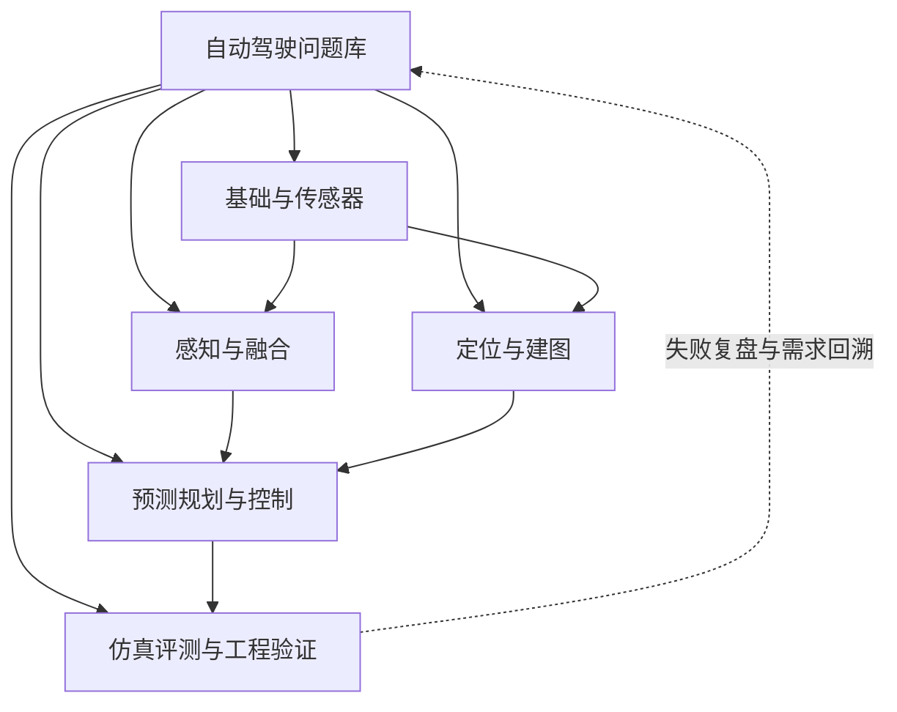
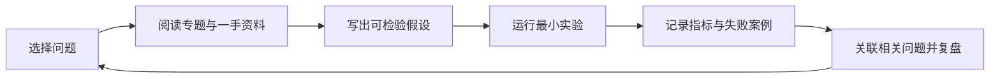

# 自动驾驶问题库：专题总导航

本目录为《自动驾驶 1000 问》提供分主题学习入口。原始题目与编号统一保留在[完整问题库](../1000-questions.md)，本目录不复制整份题库，避免多个版本长期漂移。

## 专题地图

## 专题入口

| 专题 | 问题编号 | 学习重点 | 指南 |
|---|---:|---|---|
| 基础、数学与传感器 | 1–20、102、111–115 | 坐标系、概率、标定、时间戳与数据契约 | [打开](foundations-and-sensors.md) |
| 感知与多传感器融合 | 31–50、116–120、143–145 | 检测指标、融合层级、关联、噪声与异常值 | [专题指南](perception-and-fusion.md) · [第 41–50 题详解](sensor-fusion-answers-41-50.md) |
| 定位与建图 | 21–30、114–115 | GNSS/IMU、里程计、SLAM、配准与定位降级 | [打开](localization-and-mapping.md) |
| 预测、规划与控制 | 51–70、124–130 | 轨迹预测、路径/速度规划、跟踪与车辆模型 | [打开](prediction-planning-control.md) |
| 仿真、评测与工程验证 | 71–100、101–110、121–123、131–142、146–150 | 数据集、闭环评测、复现、测试和安全证据 | [打开](simulation-evaluation-engineering.md) |

## 推荐学习闭环

## 如何扩展到 1000 问

1. 先在完整问题库中分配稳定编号，再将新问题链接到对应专题指南。
2. 每个新问题应包含可检验的核心问题，必要时补充答案、公式、图示、工程案例和参考来源。
3. 只有仓库中真实存在且经过核对的实验，才可以列为可运行实验；外部项目和计划中的实验应明确标记。
4. 新增专题后，同步更新本页、完整问题库的专题入口和根目录 README。
5. 定期检查编号重复、失效链接、实验覆盖范围和题目是否仍有唯一价值。

## 验证边界

专题页是学习导航，不表示每个问题都已有完整答案或实现。当前仓库的 Python 实验主要覆盖简化状态估计、二维坐标变换、标量融合、鲁棒门控、时间/协方差处理及 Pure Pursuit；完整 SLAM、深度学习感知、独立轨迹预测器和 ROS 2/Autoware/Apollo 部署仍不属于当前实验覆盖范围。