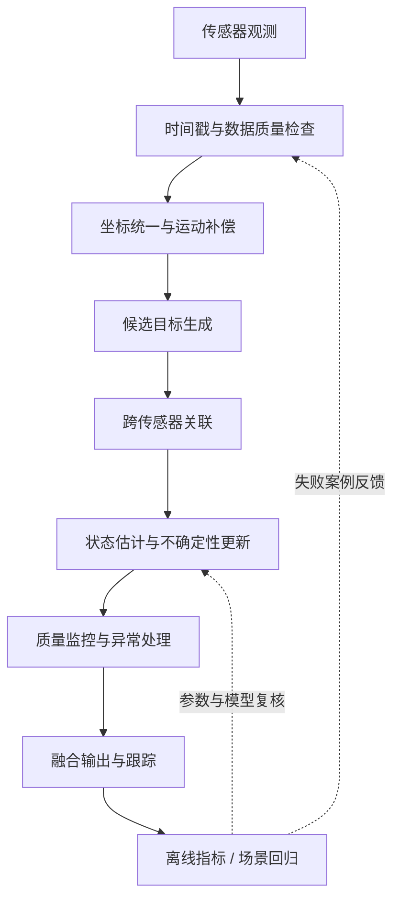

# 多传感器融合逐题详解（第 41–50 题）

> 本文对应[完整问题库](../1000-questions.md)第 41–50 题。目标是建立可验证的工程理解，不将简化公式直接当作量产系统设计。

## 题目 41：为什么需要多传感器融合，而不是只依赖单一传感器？

**核心回答：** 不同传感器对环境的观测能力、误差模式和失效条件不同。融合的价值是利用互补信息，提高状态估计或目标感知的可观测性、稳定性和可用性；前提是时间、坐标、对象身份和不确定性处理正确。

- 相机通常提供丰富的颜色、纹理和语义信息，但距离估计可能依赖模型、几何或多视角条件，且容易受光照影响。
- 激光雷达提供较直接的三维几何结构，但点云密度随距离、反射率和扫描模式变化。
- 毫米波雷达可提供径向速度线索，并在部分天气条件下保持较好的探测能力，但角分辨率、虚警和多径等问题仍需处理。
- GNSS/IMU 更偏向车辆自身运动状态，不是对道路参与者的直接感知。

融合不是“传感器越多越好”。如果多路数据共享偏差、时间错位、标定错误或误关联，融合可能把错误变得更有自信。

### 工程判断

1. 先列出每种传感器的观测量、坐标系、时间基准、噪声与失效模式。
2. 明确融合输出是什么：位置、速度、类别、目标轨迹，还是车辆自身状态。
3. 用单传感器基线、融合基线和传感器失效/退化场景进行对照。

## 题目 42：数据级、特征级和目标级融合有何差异？

| 层级 | 典型输入 | 优势 | 主要代价与风险 |
|---|---|---|---|
| 数据级 / 早期融合 | 图像像素、点云、雷达测量等原始或近原始数据 | 尽早保留细节，可能充分利用跨模态线索 | 对时间同步、外参、数据格式和算力要求高 |
| 特征级 / 中期融合 | 各模态编码器输出的特征图、BEV 特征等 | 可在表达空间融合互补语义，适合学习式模型 | 训练数据、网络结构、特征对齐与部署复杂度较高 |
| 目标级 / 晚期融合 | 各传感器独立输出的目标框、类别、速度和协方差 | 模块边界清楚，便于诊断与替换 | 信息已被上游压缩；目标关联错误会影响结果 |

不存在适用于所有场景的唯一最佳层级。设计选择取决于任务、传感器带宽、算力预算、数据标注、时延约束、故障隔离要求和可验证性。

## 题目 43：早期融合与晚期融合分别适合什么情况？

“早期/晚期”强调数据处理链中融合发生的位置，与上一题的融合层级相关但并非所有术语在不同论文中都完全一致。

- **偏早融合：** 有条件把原始数据或较低层特征对齐，且希望模型学习细粒度互补关系时可能有优势；对标定、时间同步、带宽和算力敏感。
- **偏晚融合：** 需要传感器模块独立开发、可诊断、易替换或异步运行时通常更容易工程化；但上游检测器已丢失的信息无法靠简单融合恢复。
- **混合方案：** 可在部分层级进行特征融合，同时保留独立检测与健康监控路径，兼顾信息利用和故障诊断。

应以同一数据切分、同一评价协议和明确的计算预算比较方案，不能只比较单一离线精度。

## 题目 44：相机与激光雷达融合前需要完成哪些对齐？

至少检查四类条件：

1. **几何标定：** 相机内参、畸变参数，以及 LiDAR 到相机的外参。
2. **坐标约定：** 轴方向、右手/左手约定、长度单位、变换矩阵的源和目标坐标系。
3. **时间对齐：** 传感器采集时间戳、时钟偏差、扫描周期、曝光时间与车辆运动。
4. **对象与数据质量：** 点云去畸变、图像有效区域、遮挡、视场重叠和数据有效性。

刚体坐标变换通常写为：

\[
\mathbf{p}_{C}=\mathbf{T}_{C\leftarrow L}\mathbf{p}_{L}
\]

其中齐次点 \(\mathbf{p}_L=[x,y,z,1]^T\)，矩阵 \(\mathbf{T}_{C\leftarrow L}\) 必须明确表示从 LiDAR 坐标系变换到相机坐标系。投影到图像还需要相机内参和正确的透视除法；不能把三维坐标变换与像素投影混为一谈。

对于运动中的车辆，即使外参正确，若时间戳不同，也可能因车辆或目标运动导致投影错位。仅做静态外参变换并不能替代时间同步、运动补偿和滚动快门处理。

## 题目 45：毫米波雷达的径向速度如何补充视觉信息？

雷达常能估计目标沿雷达视线方向的相对速度，而不是直接给出完整二维/三维速度向量。简化情况下：

\[
v_r = \mathbf{v}_{rel}\cdot\hat{\mathbf{r}}
\]

其中 \(\mathbf{v}_{rel}\) 是目标相对速度，\(\hat{\mathbf{r}}\) 是视线方向单位向量；实际符号约定需依据雷达接口确认。

视觉可提供类别、外观、边界和场景语义，雷达径向速度可辅助判断目标是在接近还是远离，并支持跟踪状态估计。但要注意：

- 单个径向速度无法唯一确定完整平面速度；
- 必须补偿自车运动，并明确速度参考系；
- 雷达多径、杂波、虚警、角度误差和目标关联错误都会污染速度；
- 视觉与雷达检测需在时间、空间和对象身份上建立合理对应。

验证时应分别评估静止目标、迎面目标、横穿目标、并行目标和自车转弯等场景，避免把径向速度直接当作目标纵向速度。

## 题目 46：如何进行跨传感器目标关联？

目标关联要判断来自不同传感器的观测是否指向同一个真实对象。常见流程包括：

1. 将观测变换到统一坐标系，并对时间差进行门控或补偿。
2. 构造关联代价，例如空间距离、IoU、类别一致性、速度差和外观相似度。
3. 使用门限排除明显不可能的候选。
4. 在多目标情况下用匈牙利算法等方法求解全局匹配，或采用适合场景的概率关联方法。
5. 处理未匹配观测、新生目标、暂时漏检、轨迹终止和 ID 维护。

简化的位置残差可以写为：

\[
\mathbf{r}=\mathbf{z}-\hat{\mathbf{z}},\qquad
d^2=\mathbf{r}^{T}\mathbf{S}^{-1}\mathbf{r}
\]

这里 \(\mathbf{S}\) 是残差协方差；在模型与分布假设合适时，可用马氏距离进行统计门控。单纯最近邻可能在目标密集、交叉或不确定性差异较大时发生错误关联。

评估不仅要看位置误差，还应检查 ID switch、错误合并、错误分裂、轨迹中断和关联延迟。当前仓库尚未实现完整多目标关联器。

## 题目 47：Kalman Filter 的预测与更新步骤分别做什么？

Kalman Filter 在**线性系统、线性观测、噪声近似零均值且协方差已知**等假设下，对状态均值和协方差进行递推估计。

状态预测：

\[
\hat{\mathbf{x}}_{k|k-1}=\mathbf{F}_k\hat{\mathbf{x}}_{k-1|k-1}+\mathbf{B}_k\mathbf{u}_k
\]

\[
\mathbf{P}_{k|k-1}=\mathbf{F}_k\mathbf{P}_{k-1|k-1}\mathbf{F}_k^T+\mathbf{Q}_k
\]

观测更新：

\[
\mathbf{K}_k=\mathbf{P}_{k|k-1}\mathbf{H}_k^T
(\mathbf{H}_k\mathbf{P}_{k|k-1}\mathbf{H}_k^T+\mathbf{R}_k)^{-1}
\]

\[
\hat{\mathbf{x}}_{k|k}=\hat{\mathbf{x}}_{k|k-1}+\mathbf{K}_k(\mathbf{z}_k-\mathbf{H}_k\hat{\mathbf{x}}_{k|k-1})
\]

直观上，预测根据运动模型推进状态并传播不确定性；更新用新观测修正预测，权衡模型预测与观测噪声。协方差不是装饰字段：如果过程噪声或观测噪声设定失真，滤波器可能过度信任错误来源。

## 题目 48：EKF 为什么需要线性化，线性化有什么风险？

Extended Kalman Filter（EKF）用于非线性状态转移或观测模型。它在当前状态估计附近，用雅可比矩阵近似非线性函数的局部变化，再执行类似 Kalman Filter 的协方差传播与更新。

若状态模型为 \(\mathbf{x}_k=f(\mathbf{x}_{k-1},\mathbf{u}_k)+\mathbf{w}_k\)，则在估计点附近使用：

\[
\mathbf{F}_k=\left.\frac{\partial f}{\partial\mathbf{x}}\right|_{\hat{\mathbf{x}}}
\]

风险包括：线性化点离真实状态过远、强非线性、角度环绕处理错误、雅可比实现错误、初始误差过大，以及真实噪声明显非高斯。EKF 的协方差是局部近似，不能保证多峰分布被正确表达。必要时需比较 UKF、粒子滤波或其他估计方法，但应由问题规模、计算预算和验证证据决定。

## 题目 49：如何处理传感器置信度不一致或观测冲突？

先诊断冲突来源，而不是立即平均：

- 时间戳是否过期，是否存在延迟、抖动或不同步；
- 坐标变换和标定版本是否正确；
- 两个观测是否真的属于同一目标；
- 噪声协方差是否经过数据校准，是否存在共享误差或相关噪声；
- 是否出现遮挡、反射、多径、异常值或模型分布外输入。

可使用创新/残差门控、鲁棒损失、观测质量标志、动态协方差、传感器健康监控或暂时拒绝某一路观测。拒绝策略也会误拒绝正确观测，因此应同时测量误接收与误拒绝率。

对于标量、无偏、相互独立的观测，方差加权基线为：

\[
\hat{x}=\frac{\sum_i z_i/\sigma_i^2}{\sum_i 1/\sigma_i^2},
\qquad
\sigma_{\hat{x}}^2=\frac{1}{\sum_i1/\sigma_i^2}
\]

若观测存在偏差、相关噪声或错误关联，这个简单公式不再自动保证最优，甚至可能比单传感器结果更差。

## 题目 50：如何通过消融实验判断融合模块是否真正有效？

设计公平的对照实验，而不是只报告“加入融合后指标提升”。

建议至少比较：

1. 传感器 A 单独运行；
2. 传感器 B 单独运行；
3. 简单融合基线（例如已对齐、独立噪声条件下的逆方差加权）；
4. 完整候选融合方法；
5. 去掉关键子模块的消融版本（例如移除时间门控、异常值门控或某一路传感器）。

固定数据切分、评价协议和尽可能一致的计算预算；分别报告总体结果和按距离、速度、天气、遮挡、目标类别等场景分层的结果。建议记录均值、分位数、置信区间、运行延迟和失败样例。

对当前小型实验，可从 LAB-003 的融合 RMSE 出发，使用 LAB-005 注入异常值，再用 LAB-008 比较时间偏差门控与相关噪声假设。它们只能验证简化标量问题，不能证明真实三维感知融合收益。

## 总体数据流

该图是概念级参考流程，不代表仓库已实现图中所有模块。

## 现有实验对应关系

| 实验 | 可用于验证 | 不覆盖 |
|---|---|---|
| [LAB-003](../../labs/python/sensor_fusion_1d.py) | 独立标量观测的逆方差加权与 RMSE | 真实多模态特征、目标关联、坐标/时间对齐 |
| [LAB-005](../../labs/python/sensor_fusion_robust.py) | 中位数/MAD 门控对粗大异常值的影响 | 小样本下的全面鲁棒性、真实目标级跟踪 |
| [LAB-008](../../labs/python/sensor_fusion_timing_covariance.py) | 时间偏差门控、已知相关协方差下的标量估计 | 插值、运动补偿、时钟漂移估计、完整融合链 |

## 建议的下一组实验

1. 固定随机种子，生成可控的双传感器标量数据。
2. 对比单传感器、独立假设加权、异常值门控与相关噪声估计。
3. 系统扫描异常值比例、偏差幅度、相关系数和时间偏差。
4. 输出 RMSE、偏差、估计方差、观测拒绝率和运行时间。
5. 加入边界测试，并保留每个配置的原始输出和测试结果。

任何实验结论都必须附带数据生成假设与适用边界；不能将合成标量实验的结论直接外推到真实车辆系统。

## 关联问题与资料

- [完整问题库第 41–50 题](../1000-questions.md)
- [感知与融合专题导航](perception-and-fusion.md)
- [论文与研究方向](../papers-and-research.md)
- [数据集与评测基准](../datasets-and-benchmarks.md)
- [实验总览](../../labs/README.md)
