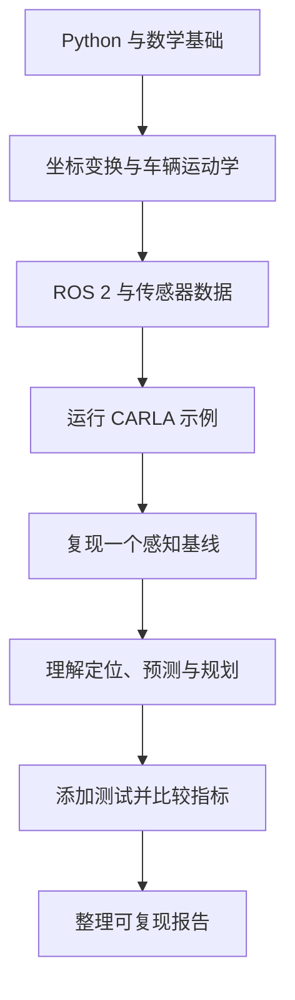

# 自动驾驶优质学习资源与 GitHub 项目地图

本清单用于发现值得学习的开源项目、论文代码、仿真器和数据集。GitHub 搜索不可能穷尽所有项目，因此这里采用“主题覆盖 + 官方来源优先 + 可复现性检查”的方式持续扩展。**收录不代表项目已在本仓库中运行验证，也不代表项目仍然活跃或可商用。**

## 1. 总览清单与发现入口

- [Awesome Autonomous Driving（autodriving-heart）](https://github.com/autodriving-heart/Awesome-Autonomous-Driving)：中文社区资源地图。
- [Awesome Autonomous Driving（autonomousdrivingkr）](https://github.com/autonomousdrivingkr/Awesome-Autonomous-Driving)：英文资源清单。
- [Awesome Autonomous Vehicles](https://github.com/manfreddiaz/awesome-autonomous-vehicles)：基础、课程、论文、数据集和软件索引。
- [Awesome Autonomous Driving Papers](https://github.com/maudzung/Awesome-Autonomous-Driving-Papers)：论文与感知研究线索。
- [GitHub Topics: autonomous-driving](https://github.com/topics/autonomous-driving) · [self-driving-car](https://github.com/topics/self-driving-car) · [autonomous-vehicles](https://github.com/topics/autonomous-vehicles)：持续发现新项目的入口。

## 2. 完整软件栈与系统集成

| 项目 | 适合学习什么 | 新手建议 |
|---|---|---|
| [Apollo](https://github.com/ApolloAuto/apollo) | 自动驾驶软件栈、模块通信、工程集成 | 先看架构文档，再追踪一个模块 |
| [Autoware](https://github.com/autowarefoundation/autoware) | 基于 ROS 2 的自动驾驶系统 | 从官方安装和模拟环境入手 |
| [Autoware Universe](https://github.com/autowarefoundation/autoware_universe) | 自动驾驶功能包与算法模块 | 先选一个包，不要通读整个仓库 |
| [openpilot](https://github.com/commaai/openpilot) | 车辆软件工程、模型和车辆接口 | 阅读架构与测试说明；不要直接接车实验 |
| [ROS 2](https://github.com/ros2/ros2) | 节点、Topic、服务、消息与通信 | 初学者先学官方教程 |
| [Lanelet2](https://github.com/fzi-forschungszentrum-informatik/Lanelet2) | 车道级地图和道路语义 | 先理解地图元素与坐标系 |

官方入口：[ROS 2 Tutorials](https://docs.ros.org/en/rolling/Tutorials.html) · [Autoware 文档](https://docs.autoware.org/) · [Apollo 开发者平台](https://apollo.baidu.com/)。

## 3. 仿真器、场景与验证

| 项目 | 用途 | 入门切入点 |
|---|---|---|
| [CARLA](https://github.com/carla-simulator/carla) | 城市场景、车辆、传感器和驾驶仿真 | Python API、传感器与固定路线 |
| [Scenario Runner](https://github.com/carla-simulator/scenario_runner) | 运行可重复驾驶场景 | 从官方示例场景开始 |
| [CARLA ROS Bridge](https://github.com/carla-simulator/ros-bridge) | CARLA 与 ROS 生态连接 | 对齐 CARLA 与 ROS 版本 |
| [CommonRoad](https://github.com/CommonRoad) | 规划场景、运动规划和可行性验证 | 从场景格式与简单规划器开始 |
| [CommonRoad Scenario Designer](https://github.com/CommonRoad/commonroad-scenario-designer) | 场景编辑与格式转换 | 先转换一个示例场景 |
| [ASAM OpenDRIVE](https://www.asam.net/standards/detail/opendrive/) | 道路网络描述标准 | 理解道路几何与车道结构 |
| [ASAM OpenSCENARIO](https://www.asam.net/standards/detail/openscenario/) | 场景描述标准 | 核对标准版本与具体实现 |

CARLA、Scenario Runner、ROS Bridge 的版本需要相互匹配；不同 OpenSCENARIO 版本和实现也可能不兼容。

## 4. 摄像头、点云与 3D 感知

| 项目 | 方向 | 建议怎样学习 |
|---|---|---|
| [OpenPCDet](https://github.com/open-mmlab/OpenPCDet) | LiDAR 3D 目标检测 | 先跑预训练模型，再读配置与评测代码 |
| [MMDetection3D](https://github.com/open-mmlab/mmdetection3d) | 3D 检测框架与模型基线 | 从一个数据集配置开始 |
| [BEVFusion](https://github.com/mit-han-lab/bevfusion) | 相机与 LiDAR 的 BEV 多模态融合 | 理解坐标变换与融合位置；核对仓库状态 |
| [CenterPoint](https://github.com/tianweiy/CenterPoint) | 基于中心点的 3D 检测与跟踪 | 从论文图、数据格式和评测脚本开始 |
| [TransFusion](https://github.com/XuyangBai/TransFusion) | 多模态 3D 检测融合 | 对照论文与代码实现 |
| [OpenCV](https://github.com/opencv/opencv) | 图像处理与传统视觉 | 从图像读取、几何变换和特征开始 |
| [PyTorch Tutorials](https://pytorch.org/tutorials/) | 深度学习训练与推理 | 先学张量、训练循环和模型保存 |

## 5. BEV、端到端驾驶与驾驶推理

| 项目 | 方向 | 阅读建议 |
|---|---|---|
| [OpenDriveLab](https://github.com/OpenDriveLab) | 自动驾驶研究项目集合 | 从组织主页按主题找项目 |
| [UniAD](https://github.com/OpenDriveLab/UniAD) | 统一自动驾驶任务研究 | 先看论文总图，再追踪输入输出 |
| [End-to-end Autonomous Driving](https://github.com/OpenDriveLab/End-to-end-Autonomous-Driving) | 端到端驾驶研究资源与实现 | 区分论文、代码和复现状态 |
| [DriveLM](https://github.com/OpenDriveLab/DriveLM) | 驾驶场景中的语言推理与数据 | 先读数据结构和任务定义 |
| [nuPlan devkit](https://github.com/motional/nuplan-devkit) | 规划算法离线评估工作流 | 先理解场景、规划器和评测指标 |
| [Microsoft Autonomous Driving Cookbook](https://github.com/microsoft/AutonomousDrivingCookbook) | 教学示例与早期自动驾驶实验 | 仓库已归档，适合历史学习，不要默认旧依赖仍适用 |

研究代码往往依赖特定 CUDA、PyTorch、数据版本和预训练权重。复现时请锁定 commit 或 release，并记录环境与指标。

## 6. 定位、建图与状态估计

- [SLAM in Autonomous Driving](https://github.com/gaoxiang12/slam_in_autonomous_driving)：结合自动驾驶背景学习 SLAM。
- [ROS 2](https://github.com/ros2/ros2)：机器人通信和 TF 基础设施。
- [Autoware](https://github.com/autowarefoundation/autoware)：查看定位模块如何集成到系统。
- [KITTI Odometry](https://www.cvlibs.net/datasets/kitti/eval_odometry.php)：经典视觉里程计与 SLAM 评测入口。
- [Oxford RobotCar Dataset](https://robotcar-dataset.robots.ox.ac.uk/)：跨时间、天气与环境的长期驾驶数据。

建议顺序：坐标系与刚体变换 → IMU/GNSS 基础 → 里程计 → SLAM → 地图匹配与定位评估。

## 7. 预测、规划与控制

- [CommonRoad](https://github.com/CommonRoad)：场景、规划和可验证性相关工具。
- [nuPlan devkit](https://github.com/motional/nuplan-devkit)：规划研究与离线评估。
- [Autoware Universe](https://github.com/autowarefoundation/autoware_universe)：查看系统中的规划与控制功能包。
- [Apollo](https://github.com/ApolloAuto/apollo)：查看规划、控制模块及系统接口。
- 本仓库的 [Pure Pursuit 实验](../labs/python/pure_pursuit.py)：从简单轨迹跟踪开始理解控制。

建议先掌握车辆运动学、坐标变换和基础 PID，再学习路径规划、轨迹优化与复杂行为决策。

## 8. 数据集与评测基准

| 数据集 | 主要用途 | 官网 |
|---|---|---|
| KITTI | 视觉、立体、里程计与 3D 检测 | [官网](https://www.cvlibs.net/datasets/kitti/) |
| nuScenes | 多传感器感知与预测 | [官网](https://www.nuscenes.org/) |
| Waymo Open Dataset | 大规模驾驶场景与感知任务 | [官网](https://waymo.com/open/) |
| Argoverse 2 | 感知、地图与运动预测 | [官网](https://www.argoverse.org/av2.html) |
| BDD100K | 道路视频与多任务感知 | [官网](https://www.vis.xyz/bdd100k/) |
| SemanticKITTI | LiDAR 点云语义分割 | [官网](https://semantic-kitti.org/) |
| DAIR-V2X | 车路协同感知 | [官网](https://thudair.baai.ac.cn/) |
| ONCE | 大规模自动驾驶感知数据 | [官网](https://once-for-auto-driving.github.io/) |
| PandaSet | 多传感器驾驶数据 | [官网](https://scale.com/open-datasets/pandaset) |
| Zenseact Open Dataset | 驾驶场景与感知研究 | [官网](https://zod.zenseact.com/) |
| Oxford RobotCar | 长期道路采集与定位研究 | [官网](https://robotcar-dataset.robots.ox.ac.uk/) |
| JAAD | 行人行为与驾驶交互 | [项目入口](https://github.com/ykotseruba/JAAD) |
| TJ4DRadSet | 4D 雷达相关研究 | [项目入口](https://github.com/TJRadarLab/TJ4DRadSet) |
| Boreas | 恶劣天气与长期定位研究 | [项目入口](https://github.com/utiasASRL/pyboreas) |

数据集注册要求、下载条件、用途限制、标注格式和评测协议各不相同。使用前必须阅读许可，不要默认可用于商业用途。

## 9. 论文与课程入口

- [arXiv](https://arxiv.org/)：论文预印本检索，预印本不一定经过同行评审。
- [CVPR](https://cvpr.thecvf.com/) · [ICCV](https://iccv.thecvf.com/) · [ECCV](https://eccv.ecva.net/)：计算机视觉与感知。
- [IEEE IV Symposium](https://ieee-iv.org/) · [IEEE ITSC](https://ieee-itsc.org/)：智能车辆与智能交通。
- [ICRA](https://www.ieee-icra.org/) · [IROS](https://www.iros.org/) · [RSS](https://roboticsconference.org/)：机器人、规划与控制。
- [PyTorch Tutorials](https://pytorch.org/tutorials/)：深度学习基础。
- [CARLA Documentation](https://carla.readthedocs.io/)：仿真环境与 Python API。
- [ROS 2 Tutorials](https://docs.ros.org/en/rolling/Tutorials.html)：机器人中间件基础。

## 10. 如何判断一个 GitHub 项目是否值得学习？

1. **看官方 README**：目标、依赖和运行方式是否清楚。
2. **看 LICENSE**：代码、模型权重和数据集可能有不同条款。
3. **检查复现说明**：是否提供版本、配置、数据准备和评测命令。
4. **检查维护状态**：发布、Issue、PR 和兼容性说明可作参考，但不能只看 Star 数。
5. **先跑最小示例**：不要一开始就下载完整数据集或训练大模型。
6. **记录实验结果**：保存 commit、环境、配置、指标和失败案例。
7. **区分证据强度**：论文结果、离线指标、仿真结果和真实道路安全不是一回事。

## 11. 推荐的入门实践顺序

每次只选一个小目标，例如“读取一帧点云并显示”“解释一个检测配置”“让车辆跟踪一条简单路线”。完成后记录理解、失败原因和下一步验证计划。

## 12. 维护说明

这是持续更新的资源索引，而不是对 GitHub 全站的穷尽性收录。提交新项目时，请优先提供官方仓库、文档、论文、许可证、入门文件路径和已知限制，并定期复核链接与项目状态。
