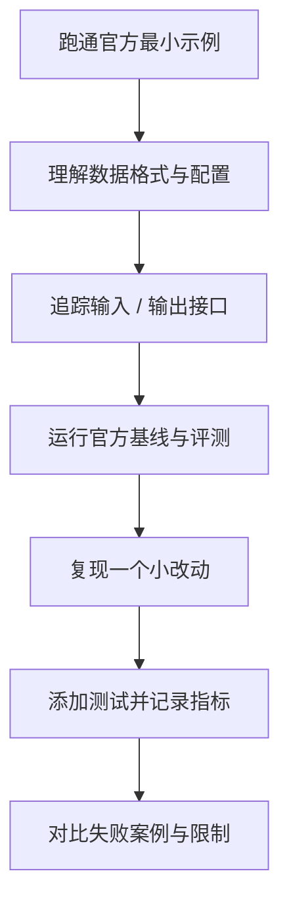

# 自动驾驶优质学习资源导航

按主题组织资源，优先保留官方文档、课程、原始论文或可运行代码。部分项目变化很快，开始前请核对版本、依赖和许可证。

## 1. 总览型清单

- [Awesome Autonomous Driving（autodriving-heart）](https://github.com/autodriving-heart/Awesome-Autonomous-Driving)：中文社区整理，覆盖感知、BEV、融合、定位建图、规划控制、部署等方向；适合发现主题和论文线索。
- [Awesome Autonomous Driving（autonomousdrivingkr）](https://github.com/autonomousdrivingkr/Awesome-Autonomous-Driving)：英文资源清单，覆盖综述、感知、规划、控制、端到端、数据集、课程和软件。
- [Awesome Autonomous Vehicles](https://github.com/manfreddiaz/awesome-autonomous-vehicles)：自动驾驶相关基础、课程、论文、研究机构、数据集和软件索引。
- [Awesome Autonomous Driving Papers](https://github.com/maudzung/Awesome-Autonomous-Driving-Papers)：以感知研究和相关数据集为主的论文整理。
- [Awesome Autonomous Driving Radar](https://github.com/lxystar00/awesome-autonomous-driving-radar)：偏近期论文与行业动态；自动化汇总可能存在排序偏差，应回到论文、代码和正式发表信息核验。

## 2. 官方系统与机器人中间件

- [Autoware GitHub](https://github.com/autowarefoundation/autoware) · [官方文档](https://docs.autoware.org/)：模块化开源自动驾驶栈，适合学习 ROS 2 工程集成。
- [Apollo GitHub](https://github.com/ApolloAuto/apollo) · [开发者平台](https://apollo.baidu.com/)：自动驾驶软件栈与工程工具。
- [ROS 2 Documentation](https://docs.ros.org/) · [教程](https://docs.ros.org/en/rolling/Tutorials.html)：节点、通信、参数、Launch、TF、工具链。
- [Lanelet2](https://github.com/fzi-forschungszentrum-informatik/Lanelet2)：车道级地图与道路语义。
- [Autoware Universe](https://github.com/autowarefoundation/autoware.universe)：Autoware 生态中的功能包集合；具体包的维护状态和版本兼容性需逐项检查。

## 3. 仿真与场景测试

- [CARLA](https://github.com/carla-simulator/carla) · [文档](https://carla.readthedocs.io/)：开源驾驶仿真、传感器模拟、场景和闭环评估。
- [Scenario Runner](https://github.com/carla-simulator/scenario_runner)：CARLA 场景执行和测试工具；确认所选分支与 CARLA 版本兼容。
- [CARLA ROS Bridge](https://github.com/carla-simulator/ros-bridge)：CARLA 与 ROS 生态的接口；检查所用 ROS 发行版和 CARLA 版本。
- [CommonRoad](https://commonroad.in.tum.de/)：运动规划基准、场景与可行性验证资源。
- [ASAM OpenDRIVE](https://www.asam.net/standards/detail/opendrive/)：道路网络描述标准；查看标准许可与版本。

## 4. 感知、深度学习与 3D 检测

- [OpenPCDet](https://github.com/open-mmlab/OpenPCDet)：点云 3D 检测研究代码。
- [MMDetection3D](https://github.com/open-mmlab/mmdetection3d)：3D 检测框架、数据转换和模型实现。
- [OpenMMLab](https://github.com/open-mmlab)：计算机视觉相关工具和框架集合。
- [OpenCV](https://github.com/opencv/opencv) · [文档](https://docs.opencv.org/)：图像处理与视觉基础。
- [PyTorch Tutorials](https://pytorch.org/tutorials/)：深度学习训练、推理和模型调试。

## 5. 数据集与评测

- [KITTI](https://www.cvlibs.net/datasets/kitti/)：经典视觉、立体、光流、定位与 3D 检测基准。
- [nuScenes](https://www.nuscenes.org/)：多传感器自动驾驶数据和基准。
- [Waymo Open Dataset](https://waymo.com/open/)：大规模自动驾驶数据和评测任务。
- [Argoverse](https://www.argoverse.org/)：感知、地图与运动预测相关数据和基准。
- [BDD100K](https://www.vis.xyz/bdd100k/)：多样道路场景视频及感知标注。
- [DAIR-V2X](https://thudair.baai.ac.cn/)：车路协同/基础设施协同感知数据方向。

数据集的下载条件、用途限制、标注格式和评测服务器规则各不相同；不得默认所有数据均可用于商业用途。

## 6. 论文与学术检索

- [arXiv](https://arxiv.org/)：预印本检索；预印本不一定经过同行评审。
- [CVPR](https://cvpr.thecvf.com/)、[ICCV](https://iccv.thecvf.com/)、[ECCV](https://eccv.ecva.net/)：视觉与感知。
- [IEEE IV Symposium](https://ieee-iv.org/)、[IEEE ITSC](https://ieee-itsc.org/)：智能车辆与智能交通。
- [RSS](https://roboticsconference.org/)、[ICRA](https://www.ieee-icra.org/)、[IROS](https://www.iros.org/)：机器人、规划与控制。
- [NeurIPS](https://neurips.cc/)、[ICML](https://icml.cc/)、[ICLR](https://iclr.cc/)：机器学习方法。

## 7. 如何判断资源质量

1. **来源**：优先官方项目、作者代码、论文原文和正式文档。
2. **可复现性**：是否提供环境、配置、数据划分、训练/评测命令。
3. **评测可信度**：是否说明数据集、指标、对比基线和限制。
4. **维护情况**：近期提交、开放问题、兼容矩阵和发布版本。
5. **适用边界**：仿真结果、离线指标和真实道路表现不能互相替代。
6. **许可证**：代码许可证与数据集使用条款分别核验。

## 8. 值得跟进的 GitHub 工程与研究代码

以下项目用于建立代码阅读路线。它们的依赖、模型权重、数据访问方式和许可证各不相同；开始前请先查看项目主页、最新 release、安装指南和 LICENSE，不要默认所有代码及权重均可商用。

### 3D 感知与多传感器融合

- [OpenPCDet](https://github.com/open-mmlab/OpenPCDet)：点云 3D 检测工具箱，适合从数据配置、模型构建到评测脚本逐层阅读。
- [MMDetection3D](https://github.com/open-mmlab/mmdetection3d)：统一的 3D 检测研究框架，适合对照不同模型与数据集适配方式。
- [BEVFusion](https://github.com/mit-han-lab/bevfusion)：相机与 LiDAR 融合、BEV 表征相关研究代码。
- [CenterPoint](https://github.com/tianweiy/CenterPoint)：基于中心点表征的 3D 检测与跟踪研究实现。
- [TransFusion](https://github.com/XuyangBai/TransFusion)：面向 3D 检测的多模态融合研究方向。

### 端到端驾驶与规划研究

- [OpenDriveLab](https://github.com/OpenDriveLab)：自动驾驶、端到端驾驶与相关研究项目集合，适合沿组织主页发现项目。
- [UniAD](https://github.com/OpenDriveLab/UniAD)：统一自动驾驶任务建模的研究项目；需核对当前代码、权重与数据许可。
- [nuPlan](https://github.com/motional/nuplan-devkit)：面向规划研究的开发工具与评测工作流。
- [CommonRoad](https://github.com/CommonRoad)：车辆运动规划、场景描述与可验证规划相关工具。
- [Frenetix](https://github.com/CommonRoad)：CommonRoad 生态中的采样式轨迹规划工具项目；使用前核对当前维护状态和接口。

### 仿真、场景与测试

- [CARLA](https://github.com/carla-simulator/carla)：开源驾驶仿真器。
- [Scenario Runner](https://github.com/carla-simulator/scenario_runner)：CARLA 场景执行与测试工具。
- [CommonRoad Scenario Designer](https://github.com/CommonRoad/commonroad-scenario-designer)：道路网络和场景转换、编辑相关工具。
- [ASAM OpenSCENARIO](https://www.asam.net/standards/detail/openscenario/)：场景描述标准入口；注意 OpenSCENARIO 不同版本与 XML/DSL 生态的区别。

### 机器人中间件与系统集成

- [ROS 2](https://github.com/ros2/ros2)：机器人中间件相关源代码入口；初学者优先阅读官方教程。
- [Autoware](https://github.com/autowarefoundation/autoware)：基于 ROS 2 生态的自动驾驶软件栈。
- [Apollo](https://github.com/ApolloAuto/apollo)：自动驾驶软件栈与配套工具。
- [Lanelet2](https://github.com/fzi-forschungszentrum-informatik/Lanelet2)：道路语义地图与车道网络处理。

### 建议的代码阅读顺序

不要仅按 GitHub Star 数判断项目质量。应综合考察论文与代码是否对应、版本是否可运行、评测脚本是否完整、Issue 是否有维护响应、许可证是否适合自己的用途，以及结果能否在相同协议下复现。
